# ESQUEMA RELACIONAL ESTRELLA EMPRESARIAL: SANTOLAYA CONSTRUCTORA E INMOBILIARIA
**Capa de Persistencia:** Microsoft Fabric OneLake (Gold Layer - Delta Tables con V-Order)  
**Motor de Consumo:** Power BI Pro en Direct Lake (`directLakeBehavior = directLakeOnly`) & Fabric SQL Analytics Endpoint  
**Versión del Esquema:** 2.1 (Producción Homologada)

---

## 1. VISIÓN GENERAL Y PRINCIPIOS ARQUITECTÓNICOS

El presente modelo dimensional adopta el patrón de **Constelación de Hechos (Fact Constellation)** con **Dimensiones Conformes (Conformed Dimensions)**. Este diseño permite analizar el ciclo de vida completo de los proyectos de Santolaya: desde la estructuración y venta inmobiliaria (blanco, verde, entrega inmediata), pasando por el control presupuestario y avance físico de obra (EVM 4-Vías y curva S), hasta la liquidación de subcontratos y la atención de postventa técnica.

```
                  ┌────────────────────────────────────────┐
                  │          DIMENSIONES CONFORMES         │
                  │   dim_proyecto_obra  │  dim_tiempo     │
                  │   dim_tercero        │  dim_empresa    │
                  │   dim_centro_costo   │  dim_seguridad  │
                  └───────────────┬────────────────────────┘
                                  │
         ┌────────────────────────┴────────────────────────┐
         ▼                                                 ▼
┌───────────────────────────────┐         ┌───────────────────────────────┐
│     DOMINIO CONSTRUCTORA      │         │      DOMINIO INMOBILIARIA     │
│                               │         │                               │
│ • fact_evm_avance_obra        │         │ • fact_ventas_inmobiliarias   │
│ • fact_compras_compromisos    │         │ • fact_postventa_servicio     │
│ • fact_recepciones_bodega     │         │ • dim_unidad_inmobiliaria     │
│ • fact_facturacion_contratista│         │                               │
└───────────────────────────────┘         └───────────────────────────────┘
```

### Reglas de Diseño Direct Lake:
1. **Modelado Puro en Estrella:** Relaciones unidireccionales de 1 a Muchos ($1:\infty$) desde las dimensiones hacia las tablas de hechos.
2. **Cero Columnas Calculadas DAX:** Todas las transformaciones, concatenaciones y clasificaciones de negocio se materializan físicamente en OneLake Silver/Gold vía PySpark.
3. **Optimización Física:** Tablas Delta Parquet ordenadas mediante algoritmo **V-Order** e indexadas por identificadores enteros surrogados (`SK_*`) para evitar la degradación de memoria en la capacidad F8.

---

## 2. DIAGRAMA ENTIDAD-RELACIÓN INTEGRADO (GOLD STAR SCHEMA)

```mermaid
erDiagram
    %% =========================================================================
    %% DIMENSIONES CONFORMES Y MAESTRAS
    %% =========================================================================

    DIM_EMPRESA_SOCIEDAD {
        bigint sk_empresa_sociedad PK
        string rut_sociedad
        string razon_social
        string codigo_sociedad_sap
    }

    DIM_PROYECTO_OBRA {
        bigint sk_proyecto_obra PK
        string codigo_obra_sap UK
        string nombre_proyecto
        string tipo_negocio
        bigint sk_empresa_sociedad FK
        string comuna
        string region
        string direccion_obra
        decimal superficie_construida_m2
        int cantidad_unidades_totales
        date fecha_inicio_programada
        date fecha_termino_contractual
        string jefe_obra_email
        string administrador_obra_email
        string estado_proyecto
    }

    DIM_TIEMPO {
        bigint sk_fecha PK
        date fecha
        int anio
        int mes_numero
        string mes_nombre
        string anio_mes
        string trimestre
        int semana_anio
        boolean dia_habil_construccion
        decimal valor_uf_cierre
    }

    DIM_TERCERO {
        bigint sk_tercero PK
        string codigo_socio_sap UK
        string rut_dni
        string razon_social_nombre
        string tipo_tercero
        string calificacion_riesgo
        string cuenta_bancaria_asociada
    }

    DIM_CENTRO_COSTO {
        bigint sk_centro_costo PK
        string codigo_norma_reparto
        string nombre_centro_costo
        int dimension_contable
    }

    DIM_PARTIDA_EDT {
        bigint sk_partida_edt PK
        string codigo_partida
        string nombre_partida
        string capitulo_edt
        string unidad_medida
    }

    DIM_UNIDAD_INMOBILIARIA {
        bigint sk_unidad_inmobiliaria PK
        bigint sk_proyecto_obra FK
        string codigo_unidad
        string tipo_unidad
        string modelo_tipologia
        int numero_piso
        string orientacion
        decimal superficie_util_m2
        decimal superficie_terraza_m2
        decimal superficie_total_m2
        string estado_comercial_actual
    }

    SEGURIDAD_USUARIOS_OBRA {
        bigint sk_seguridad PK
        string user_email
        string codigo_obra_sap
        string rol_usuario
        boolean acceso_total
    }

    %% =========================================================================
    %% TABLAS DE HECHOS: CONSTRUCTORA
    %% =========================================================================

    FACT_EVM_AVANCE_OBRA {
        bigint sk_evm PK
        bigint sk_proyecto_obra FK
        bigint sk_fecha FK
        bigint sk_partida_edt FK
        decimal monto_bac_presupuesto_base
        decimal monto_pv_planificado
        decimal monto_ev_ganado
        decimal monto_ac_costo_real
        decimal porcentaje_avance_fisico
        decimal porcentaje_avance_financiero
    }

    FACT_COMPRAS_COMPROMISOS {
        bigint sk_compra PK
        bigint sk_proyecto_obra FK
        bigint sk_tercero_proveedor FK
        bigint sk_centro_costo FK
        bigint sk_partida_edt FK
        bigint sk_fecha_emision FK
        string num_oc_sap
        decimal cantidad_ordenada
        decimal monto_comprometido_neto_clp
        decimal monto_comprometido_uf
        string estado_aprobacion
    }

    FACT_RECEPCIONES_BODEGA {
        bigint sk_recepcion PK
        bigint sk_proyecto_obra FK
        bigint sk_tercero_proveedor FK
        bigint sk_partida_edt FK
        bigint sk_fecha_recepcion FK
        string num_guia_despacho
        string num_entrada_sap
        decimal cantidad_recibida
        decimal monto_recepcionado_clp
        boolean indicador_conforme
    }

    FACT_FACTURACION_CONTRATISTA {
        bigint sk_factura_contratista PK
        bigint sk_proyecto_obra FK
        bigint sk_tercero_contratista FK
        bigint sk_centro_costo FK
        bigint sk_fecha_contable FK
        string num_factura_tributaria
        string num_estado_pago_ep
        decimal monto_bruto_clp
        decimal monto_retencion_garantia_clp
        decimal monto_liquido_a_pago_clp
        string certificacion_laboral_f30
    }

    %% =========================================================================
    %% TABLAS DE HECHOS: INMOBILIARIA
    %% =========================================================================

    FACT_VENTAS_INMOBILIARIAS {
        bigint sk_venta PK
        bigint sk_proyecto_obra FK
        bigint sk_unidad_inmobiliaria FK
        bigint sk_tercero_cliente FK
        bigint sk_tercero_broker FK
        bigint sk_fecha_operacion FK
        string etapa_comercial
        decimal precio_lista_uf
        decimal precio_cierre_uf
        decimal monto_pie_uf
        decimal monto_credito_hipotecario_uf
        decimal monto_subsidio_uf
        decimal monto_desistimiento_uf
        int dias_ciclo_promesa_escritura
    }

    FACT_POSTVENTA_SERVICIO {
        bigint sk_postventa PK
        bigint sk_proyecto_obra FK
        bigint sk_unidad_inmobiliaria FK
        bigint sk_tercero_cliente FK
        bigint sk_fecha_apertura FK
        bigint sk_fecha_cierre FK
        string ticket_servicio_sap
        string recinto_afectado
        string tipologia_falla
        decimal costo_reparacion_clp
        int dias_resolucion
        string estado_ticket
    }

    %% =========================================================================
    %% RELACIONES DIMENSIONALES (1:N)
    %% =========================================================================

    DIM_EMPRESA_SOCIEDAD ||--o{ DIM_PROYECTO_OBRA : "posee sociedad legal"
    DIM_PROYECTO_OBRA ||--o{ DIM_UNIDAD_INMOBILIARIA : "contiene catalogo inventario"
    DIM_PROYECTO_OBRA ||--o{ SEGURIDAD_USUARIOS_OBRA : "gobierna accesos RLS"

    DIM_PROYECTO_OBRA ||--o{ FACT_EVM_AVANCE_OBRA : "controla avance fisico"
    DIM_PROYECTO_OBRA ||--o{ FACT_COMPRAS_COMPROMISOS : "imputa ordenes compra"
    DIM_PROYECTO_OBRA ||--o{ FACT_RECEPCIONES_BODEGA : "recibe materiales faena"
    DIM_PROYECTO_OBRA ||--o{ FACT_FACTURACION_CONTRATISTA : "liquida estados pago"

    DIM_TIEMPO ||--o{ FACT_EVM_AVANCE_OBRA : "fecha snapshot semanal"
    DIM_TIEMPO ||--o{ FACT_COMPRAS_COMPROMISOS : "fecha emision OC"
    DIM_TIEMPO ||--o{ FACT_RECEPCIONES_BODEGA : "fecha recepcion bodega"
    DIM_TIEMPO ||--o{ FACT_FACTURACION_CONTRATISTA : "fecha contable devengo"

    DIM_TERCERO ||--o{ FACT_COMPRAS_COMPROMISOS : "proveedor adjudicado"
    DIM_TERCERO ||--o{ FACT_RECEPCIONES_BODEGA : "proveedor despachador"
    DIM_TERCERO ||--o{ FACT_FACTURACION_CONTRATISTA : "contratista acreedor"

    DIM_CENTRO_COSTO ||--o{ FACT_COMPRAS_COMPROMISOS : "norma reparto compras"
    DIM_CENTRO_COSTO ||--o{ FACT_FACTURACION_CONTRATISTA : "distribucion contable EP"

    DIM_PARTIDA_EDT ||--o{ FACT_EVM_AVANCE_OBRA : "partida presupuestaria"
    DIM_PARTIDA_EDT ||--o{ FACT_COMPRAS_COMPROMISOS : "item costo imputado"
    DIM_PARTIDA_EDT ||--o{ FACT_RECEPCIONES_BODEGA : "insumo recibido"

    DIM_PROYECTO_OBRA ||--o{ FACT_VENTAS_INMOBILIARIAS : "comercializa proyecto"
    DIM_PROYECTO_OBRA ||--o{ FACT_POSTVENTA_SERVICIO : "atiende garantias obra"

    DIM_TIEMPO ||--o{ FACT_VENTAS_INMOBILIARIAS : "fecha hito comercial"
    DIM_TIEMPO ||--o{ FACT_POSTVENTA_SERVICIO : "fecha apertura reclamo"

    DIM_TERCERO ||--o{ FACT_VENTAS_INMOBILIARIAS : "cliente comprador / broker"
    DIM_TERCERO ||--o{ FACT_POSTVENTA_SERVICIO : "propietario reclamante"

    DIM_UNIDAD_INMOBILIARIA ||--o{ FACT_VENTAS_INMOBILIARIAS : "unidad transada"
    DIM_UNIDAD_INMOBILIARIA ||--o{ FACT_POSTVENTA_SERVICIO : "unidad con incidente"
```



---

## 3. DICCIONARIO DE DIMENSIONES CONFORMES

### 3.1 `dim_proyecto_obra` (Dimensión Maestra Integradora)
Conecta la visión de obra física con la visión de estructuración societaria e inmobiliaria.
* **Granularidad:** Un registro por cada proyecto / etapa constructiva o desarrollo inmobiliario.

| Columna | Tipo Delta | Restricción | Descripción de Negocio | Origen SAP B1 / Core |
| :--- | :--- | :--- | :--- | :--- |
| `sk_proyecto_obra` | `BIGINT` | PRIMARY KEY | Clave surrogada entera autoincremental | Hashing `PrjCode` |
| `codigo_obra_sap` | `VARCHAR(20)` | UNIQUE NOT NULL | Identificador del proyecto en SAP (`PrjCode`) | `OPRJ.PrjCode` |
| `nombre_proyecto` | `VARCHAR(150)` | NOT NULL | Nombre comercial y técnico del proyecto | `OPRJ.PrjName` |
| `tipo_negocio` | `VARCHAR(30)` | NOT NULL | `INMOBILIARIA`, `CONSTRUCTORA` o `MIXTO` | Lógica de negocio |
| `sk_empresa_sociedad` | `BIGINT` | FOREIGN KEY | Sociedad legal propietaria | `dim_empresa_sociedad` |
| `comuna` | `VARCHAR(60)` | NOT NULL | Comuna de emplazamiento | Maestro Obras |
| `region` | `VARCHAR(60)` | NOT NULL | Región política | Maestro Obras |
| `direccion_obra` | `VARCHAR(255)` | NULL | Dirección física de los trabajos | Maestro Obras |
| `superficie_construida_m2` | `DECIMAL(12,2)` | NOT NULL | Metros cuadrados vendibles / construidos | Permiso Edificación |
| `cantidad_unidades_totales`| `INT` | NOT NULL | Total de departamentos, locales, casas | Ficha Inmobiliaria |
| `fecha_inicio_programada` | `DATE` | NOT NULL | Fecha de inicio oficial de faena | Plan Maestro |
| `fecha_termino_contractual`| `DATE` | NOT NULL | Fecha de entrega comprometida | Plan Maestro |
| `jefe_obra_email` | `VARCHAR(120)` | NOT NULL | Correo para mapeo de seguridad RLS | Entra ID / M365 |
| `administrador_obra_email` | `VARCHAR(120)` | NOT NULL | Correo administrador para RLS | Entra ID / M365 |
| `estado_proyecto` | `VARCHAR(30)` | NOT NULL | `PROSPECCION`, `EN_EJECUCION`, `POSTVENTA`, `CERRADO` | Estado Operativo |

### 3.2 `dim_tiempo` (Calendario Corporativo Unificado)
* **Granularidad:** Un registro por día calendario (1990 - 2040).

| Columna | Tipo Delta | Descripción de Negocio |
| :--- | :--- | :--- |
| `sk_fecha` | `BIGINT` | Clave surrogada en formato entero `YYYYMMDD` |
| `fecha` | `DATE` | Fecha real de calendario |
| `anio` | `INT` | Año calendario ($2024, 2025, 2026$) |
| `mes_numero` | `INT` | Número de mes ($1 \dots 12$) |
| `mes_nombre` | `VARCHAR(20)` | Nombre del mes (`Enero`, `Febrero`, etc.) |
| `anio_mes` | `VARCHAR(7)` | Cadena `YYYY-MM` para ordenamiento |
| `trimestre` | `VARCHAR(5)` | `Q1`, `Q2`, `Q3`, `Q4` |
| `semana_anio` | `INT` | Semana de avance de obra ($1 \dots 52$) |
| `dia_habil_construccion` | `BOOLEAN` | `TRUE` si excluye domingos, festivos y feriados legales de construcción |
| `valor_uf_cierre` | `DECIMAL(10,2)` | Valor oficial de la Unidad de Fomento (UF) para la fecha |

### 3.3 `dim_tercero` (Proveedores, Subcontratistas, Clientes y Brokers)
* **Granularidad:** Un registro por persona natural o jurídica que interactúa con la compañía.

| Columna | Tipo Delta | Restricción | Descripción de Negocio | Origen SAP B1 |
| :--- | :--- | :--- | :--- | :--- |
| `sk_tercero` | `BIGINT` | PRIMARY KEY | Clave surrogada | Hashing `CardCode` |
| `codigo_socio_sap` | `VARCHAR(20)` | UNIQUE NOT NULL | Código de Socio de Negocio | `OCRD.CardCode` |
| `rut_dni` | `VARCHAR(20)` | NOT NULL | Identificador tributario (RUT con dígito verificador) | `OCRD.LicTradNum` |
| `razon_social_nombre` | `VARCHAR(200)` | NOT NULL | Razón social o nombres legales | `OCRD.CardName` |
| `tipo_tercero` | `VARCHAR(30)` | NOT NULL | `PROVEEDOR_INSUMOS`, `SUBCONTRATISTA`, `CLIENTE_COMPRADOR`, `BROKER` | `OCRD.CardType` |
| `calificacion_riesgo` | `VARCHAR(10)` | NULL | Rating interno de cumplimiento (A, B, C, D) | Evaluación Proveedores |
| `cuenta_bancaria_asociada` | `VARCHAR(50)` | NULL | Cuenta de abono para transferencias masivas | `OCRD.BankCode` |

### 3.4 `dim_centro_costo` (Control Contable SAP B1)
* **Granularidad:** Un registro por centro de costo analítico definido en las dimensiones contables de SAP B1.

| Columna | Tipo Delta | Descripción de Negocio | Origen SAP B1 |
| :--- | :--- | :--- | :--- |
| `sk_centro_costo` | `BIGINT` | Clave surrogada analítica | `OOCR` / `OCR1` |
| `codigo_norma_reparto` | `VARCHAR(20)` | Código contable de imputación | `OCR1.PrcCode` |
| `nombre_centro_costo` | `VARCHAR(100)` | Glosa del centro de costo | `OCR1.PrcName` |
| `dimension_contable` | `INT` | Dimensión de negocio en SAP ($1 = \text{Negocio}$, $2 = \text{Obra}$, $3 = \text{Etapa}$) | `OCR1.DimCode` |

### 3.5 `dim_partida_edt` (Estructura de Desglose de Trabajo - WBS)
* **Granularidad:** Registro por ítem de presupuesto de obra o partida analítica.

| Columna | Tipo Delta | Descripción de Negocio |
| :--- | :--- | :--- |
| `sk_partida_edt` | `BIGINT` | Clave surrogada de partida |
| `codigo_partida` | `VARCHAR(30)` | Código jerárquico (`01.01.03`, `02.04.01`) |
| `nombre_partida` | `VARCHAR(150)` | Glosa de la partida (ej: *Hormigón Estructural H-30 Muros*) |
| `capitulo_edt` | `VARCHAR(80)` | Nivel superior (ej: *Instalaciones*, *Terminaciones*, *Obra Gruesa*) |
| `unidad_medida` | `VARCHAR(10)` | Unidad técnica ($m^2, m^3, kg, un, gl$) |

### 3.6 `dim_unidad_inmobiliaria` (Catálogo de Producto Vendible)
* **Granularidad:** Un registro por cada departamento, local, bodega o estacionamiento de cada desarrollo.

| Columna | Tipo Delta | Descripción de Negocio |
| :--- | :--- | :--- |
| `sk_unidad_inmobiliaria` | `BIGINT` | Clave surrogada de producto vendible |
| `sk_proyecto_obra` | `BIGINT` | Proyecto al que pertenece la unidad |
| `codigo_unidad` | `VARCHAR(30)` | Código comercial (ej: `EDIF-A-DEP-1204`) |
| `tipo_unidad` | `VARCHAR(30)` | `DEPARTAMENTO`, `CASA`, `ESTACIONAMIENTO`, `BODEGA`, `LOCAL_COMERCIAL` |
| `modelo_tipologia` | `VARCHAR(50)` | Configuración (ej: `2D2B-Mariposa`, `1D1B`, `3D2B`) |
| `numero_piso` | `INT` | Nivel o elevación |
| `orientacion` | `VARCHAR(10)` | `NORTE`, `SUR`, `ORIENTE`, `PONIENTE`, `NOR-ORIENTE`, etc. |
| `superficie_util_m2` | `DECIMAL(8,2)` | Metros cuadrados interiores útiles |
| `superficie_terraza_m2` | `DECIMAL(8,2)` | Metros cuadrados de terrazas o logias |
| `superficie_total_m2` | `DECIMAL(8,2)` | Metros cuadrados totales vendibles |
| `estado_comercial_actual` | `VARCHAR(30)` | `DISPONIBLE`, `RESERVADO`, `PROMETIDO`, `ESCRITURADO`, `BLOQUEADO` |

---

## 4. DICCIONARIO DE TABLAS DE HECHOS (FACT TABLES)

### 4.1 Dominio Constructora

#### A. `fact_evm_avance_obra` (Valor Ganado y Curva S)
* **Granularidad:** Snapshot semanal por proyecto/obra y por partida presupuestaria de control.

| Columna | Tipo Delta | Naturaleza | Descripción |
| :--- | :--- | :--- | :--- |
| `sk_evm` | `BIGINT` | PK | Identificador único del snapshot de control |
| `sk_proyecto_obra` | `BIGINT` | FK | Relación con `dim_proyecto_obra` |
| `sk_fecha` | `BIGINT` | FK | Fecha de corte del informe de avance semanal |
| `sk_partida_edt` | `BIGINT` | FK | Relación con `dim_partida_edt` |
| `monto_bac_presupuesto_base`| `DECIMAL(18,2)`| Semi-aditivo | Presupuesto Base a la Conclusión ($BAC$) en CLP |
| `monto_pv_planificado` | `DECIMAL(18,2)`| Aditivo | Valor Planificado a la fecha ($PV$) en CLP |
| `monto_ev_ganado` | `DECIMAL(18,2)`| Aditivo | Valor Ganado real físico ($EV$) en CLP |
| `monto_ac_costo_real` | `DECIMAL(18,2)`| Aditivo | Costo Real devengado a la fecha ($AC$) en CLP |
| `porcentaje_avance_fisico` | `DECIMAL(5,4)` | No-aditivo | % de avance físico medido en terreno ($0.0000 \dots 1.0000$) |
| `porcentaje_avance_financiero`| `DECIMAL(5,4)`| No-aditivo | % de costo devengado sobre el presupuesto total |

#### B. `fact_compras_compromisos` (Órdenes de Compra - `OPOR`)
* **Granularidad:** Línea individual de detalle de cada Orden de Compra emitida en SAP B1.

| Columna | Tipo Delta | Naturaleza | Origen SAP B1 |
| :--- | :--- | :--- | :--- |
| `sk_compra` | `BIGINT` | PK | Hashing `DocEntry` + `LineNum` |
| `sk_proyecto_obra` | `BIGINT` | FK | `OPOR.Project` |
| `sk_tercero_proveedor` | `BIGINT` | FK | `OPOR.CardCode` |
| `sk_centro_costo` | `BIGINT` | FK | `POR1.OcrCode` / `POR1.OcrCode2` |
| `sk_partida_edt` | `BIGINT` | FK | Mapeo de insumo a Partida |
| `sk_fecha_emision` | `BIGINT` | FK | `OPOR.DocDate` |
| `num_oc_sap` | `VARCHAR(20)` | Degenerada | Folio de la OC (`OPOR.DocNum`) |
| `cantidad_ordenada` | `DECIMAL(14,4)`| Aditivo | Unidades de material contratadas |
| `monto_comprometido_neto_clp`| `DECIMAL(16,2)`| Aditivo | Compromiso de costo neto en pesos chilenos |
| `monto_comprometido_uf` | `DECIMAL(12,4)`| Aditivo | Monto indexado a UF de la fecha de emisión |
| `estado_aprobacion` | `VARCHAR(20)` | Degenerada | `PENDIENTE`, `AUTORIZADA`, `CERRADA`, `CANCELADA` |

#### C. `fact_recepciones_bodega` (Entradas de Mercancía - `OPDN`)
* **Granularidad:** Línea de entrada física de material recepcionado en la bodega de faena.

| Columna | Tipo Delta | Naturaleza | Origen SAP B1 |
| :--- | :--- | :--- | :--- |
| `sk_recepcion` | `BIGINT` | PK | Hashing `DocEntry` + `LineNum` (`OPDN`/`PDN1`) |
| `sk_proyecto_obra` | `BIGINT` | FK | `OPDN.Project` |
| `sk_tercero_proveedor` | `BIGINT` | FK | `OPDN.CardCode` |
| `sk_partida_edt` | `BIGINT` | FK | `PDN1.ItemCode` $\rightarrow$ Partida |
| `sk_fecha_recepcion` | `BIGINT` | FK | `OPDN.DocDate` |
| `num_guia_despacho` | `VARCHAR(30)` | Degenerada | Guía de despacho física del proveedor |
| `num_entrada_sap` | `VARCHAR(20)` | Degenerada | Folio entrada de mercancías (`OPDN.DocNum`) |
| `cantidad_recibida` | `DECIMAL(14,4)`| Aditivo | Unidades físicas ingresadas al inventario de obra |
| `monto_recepcionado_clp` | `DECIMAL(16,2)`| Aditivo | Costo recepcionado pendiente de factura |
| `indicador_conforme` | `BOOLEAN` | Indicador | Marcado de verificación de calidad en obra |

#### D. `fact_facturacion_contratista` (Devengado, Facturas y EP - `OPCH`)
* **Granularidad:** Detalle de factura de proveedor o subcontrato / Estado de Pago liquidado.

| Columna | Tipo Delta | Naturaleza | Origen SAP B1 / Portal EP |
| :--- | :--- | :--- | :--- |
| `sk_factura_contratista` | `BIGINT` | PK | Hashing `DocEntry` + `LineNum` (`OPCH`/`PCH1`) |
| `sk_proyecto_obra` | `BIGINT` | FK | `OPCH.Project` |
| `sk_tercero_contratista` | `BIGINT` | FK | `OPCH.CardCode` |
| `sk_centro_costo` | `BIGINT` | FK | `PCH1.OcrCode` |
| `sk_fecha_contable` | `BIGINT` | FK | Fecha de contabilización devengada |
| `num_factura_tributaria` | `VARCHAR(30)` | Degenerada | Número fiscal de Factura Electrónica (DTE) |
| `num_estado_pago_ep` | `VARCHAR(30)` | Degenerada | Folio del Estado de Pago de faena (ej: `EP-08`) |
| `monto_bruto_clp` | `DECIMAL(16,2)`| Aditivo | Monto total facturado afecto/exento |
| `monto_retencion_garantia_clp`| `DECIMAL(16,2)`| Aditivo | Retención contractural de garantía (típico $5\%$) |
| `monto_liquido_a_pago_clp` | `DECIMAL(16,2)`| Aditivo | Neto devengado a transferir al contratista |
| `certificacion_laboral_f30` | `VARCHAR(20)` | Indicador | Estado certificado F30/F30-1 (`AL_DIA`, `VENCIDO`, `RECHAZADO`) |

---

### 4.2 Dominio Inmobiliaria

#### A. `fact_ventas_inmobiliarias` (Ciclo Comercial de Venta)
* **Granularidad:** Evento o hito de cambio de estado sobre una unidad inmobiliaria (Reserva, Promesa, Escritura, Desistimiento).

| Columna | Tipo Delta | Naturaleza | Descripción / Lógica de Negocio |
| :--- | :--- | :--- | :--- |
| `sk_venta` | `BIGINT` | PK | Clave única de la transacción comercial |
| `sk_proyecto_obra` | `BIGINT` | FK | Proyecto inmobiliario |
| `sk_unidad_inmobiliaria`| `BIGINT` | FK | Unidad transada (departamento, casa, local) |
| `sk_tercero_cliente` | `BIGINT` | FK | Cliente comprador persona o inversionista |
| `sk_tercero_broker` | `BIGINT` | FK | Corredora / Broker externo o canal interno |
| `sk_fecha_operacion` | `BIGINT` | FK | Fecha en que se firma o perfecciona el hito |
| `etapa_comercial` | `VARCHAR(30)` | Degenerada | `RESERVA`, `PROMESA_BLANCO`, `PROMESA_VERDE`, `ESCRITURA`, `DESISTIMIENTO` |
| `precio_lista_uf` | `DECIMAL(10,2)`| Aditivo | Precio de catálogo publicado |
| `precio_cierre_uf` | `DECIMAL(10,2)`| Aditivo | Precio transado efectivo tras descuentos comerciales |
| `monto_pie_uf` | `DECIMAL(10,2)`| Aditivo | Monto total pagado en cuotas / cheques por pie |
| `monto_credito_hipotecario_uf`| `DECIMAL(10,2)`| Aditivo | Saldo a liquidar por banco con carta resguardo |
| `monto_subsidio_uf` | `DECIMAL(10,2)`| Aditivo | Aporte estatal (DS01, DS19) si aplica |
| `monto_desistimiento_uf`| `DECIMAL(10,2)`| Aditivo | Multa o retención retenida en caso de caída |
| `dias_ciclo_promesa_escritura`| `INT` | Aditivo | Tiempo de maduración del proceso bancario y legal |

#### B. `fact_postventa_servicio` (Garantías Técnicas y Reclamos - `OSCL`)
* **Granularidad:** Ticket o solicitud de servicio técnico de clientes de departamentos entregados.

| Columna | Tipo Delta | Naturaleza | Origen SAP B1 |
| :--- | :--- | :--- | :--- |
| `sk_postventa` | `BIGINT` | PK | Identificador único del reclamo (`OSCL.callID`) |
| `sk_proyecto_obra` | `BIGINT` | FK | Proyecto inmobiliario correspondiente |
| `sk_unidad_inmobiliaria`| `BIGINT` | FK | Departamento o unidad con incidente |
| `sk_tercero_cliente` | `BIGINT` | FK | Propietario o arrendatario afectado |
| `sk_fecha_apertura` | `BIGINT` | FK | Fecha de recepción de la llamada o ticket |
| `sk_fecha_cierre` | `BIGINT` | FK | Fecha de recepción conforme de los trabajos |
| `ticket_servicio_sap` | `VARCHAR(20)` | Degenerada | Código interno de postventa |
| `recinto_afectado` | `VARCHAR(50)` | Atributo | `COCINA`, `BAÑO_PRINCIPAL`, `TERRAZA`, `DORMITORIO` |
| `tipologia_falla` | `VARCHAR(50)` | Atributo | `GASFITERIA`, `FISURAS_ESTRUCTURALES`, `ELECTRICIDAD`, `PINTURA` |
| `costo_reparacion_clp` | `DECIMAL(12,2)`| Aditivo | Costo de mano de obra y materiales incurrido |
| `dias_resolucion` | `INT` | Métrica | Tiempo transcurrido entre apertura y conformidad |
| `estado_ticket` | `VARCHAR(20)` | Atributo | `ABIERTO`, `EN_INSPECCION`, `EN_REPARACION`, `CERRADO_CONFORME` |

---

## 5. TABLA PUENTE DE SEGURIDAD (RLS DINÁMICO)

Para dar cumplimiento a la regla arquitectónica inviolable **`INV-005`** y garantizar que las 20 licencias de Power BI Pro accedan únicamente a los proyectos asignados, se implementa la siguiente tabla de seguridad en OneLake:

### `seguridad_usuarios_obra`
* **Granularidad:** Relación N a M entre usuarios de Microsoft Entra ID (M365) y proyectos.

| Columna | Tipo Delta | Descripción |
| :--- | :--- | :--- |
| `user_email` | `VARCHAR(120)` | Correo corporativo del usuario (`USERPRINCIPALNAME()`) |
| `codigo_obra_sap` | `VARCHAR(20)` | Código de proyecto permitido (`OPRJ.PrjCode`) |
| `rol_usuario` | `VARCHAR(30)` | `JEFE_OBRA`, `ADMINISTRADOR_CONTRATO`, `GERENTE_ZONAL`, `DIRECTOR` |
| `acceso_total` | `BOOLEAN` | `TRUE` para ejecutivos y directores sin restricción territorial |

```dax
// Filtro DAX aplicado en TMDL para el rol JefeObra_RLS:
VAR UsuarioActual = USERPRINCIPALNAME()
VAR TieneAccesoTotal = 
    CALCULATE(
        MAX(seguridad_usuarios_obra[acceso_total]),
        seguridad_usuarios_obra[user_email] = UsuarioActual
    )
RETURN
    IF(
        TieneAccesoTotal = TRUE(),
        TRUE(),
        dim_proyecto_obra[codigo_obra_sap] IN 
            CALCULATETABLE(
                VALUES(seguridad_usuarios_obra[codigo_obra_sap]),
                seguridad_usuarios_obra[user_email] = UsuarioActual
            )
    )
```

---

## 6. FÓRMULAS MATEMÁTICAS Y CÁLCULOS ANALÍTICOS (DAX DIRECT LAKE)

Las siguientes métricas son calculadas al vuelo sobre el modelo semántico Direct Lake garantizando tiempo de respuesta submétrico en la capacidad Fabric F8:

### 6.1 Control de Costos y Valor Ganado (Constructora)
* **Variación de Costo:**
  $$CV = EV - AC$$
* **Variación de Cronograma:**
  $$SV = EV - PV$$
* **Índice de Desempeño de Costo ($CPI$):**
  $$CPI = \frac{EV}{AC}$$
* **Índice de Desempeño de Cronograma ($SPI$):**
  $$SPI = \frac{EV}{PV}$$
* **Estimación a la Conclusión ($EAC$):**
  $$EAC = \frac{BAC}{CPI}$$
* **Desviación Proyectada al Término ($VAC$):**
  $$VAC = BAC - EAC$$

### 6.2 Métricas de Absorción y Desempeño (Inmobiliaria)
* **Porcentaje de Colocación / Absorción Comercial:**
  $$\% \text{ Absorción} = \frac{\sum \text{Unidades Prometidas} + \sum \text{Unidades Escrituradas}}{\text{Total Unidades Vendibles}} \times 100$$
* **Descuento Promedio Aplicado sobre Lista:**
  $$\% \text{ Descuento} = \frac{\sum \text{precio\_lista\_uf} - \sum \text{precio\_cierre\_uf}}{\sum \text{precio\_lista\_uf}} \times 100$$
* **Tasa de Desistimiento:**
  $$\% \text{ Desistimiento} = \frac{\sum \text{Monto Desistimiento UF}}{\sum \text{Monto Promesado Bruto UF}} \times 100$$

---

## 7. MAPEO DE INGESTA CDC: DE SAP BUSINESS ONE A ONELAKE

La ingesta incremental se realiza vía On-Premises Data Gateway extrayendo las tablas transaccionales en modo `READ UNCOMMITTED` hacia OneLake Bronze, para su posterior transformación hacia las tablas Gold del modelo:

| Entidad SAP B1 | Tablas Transaccionales | Tabla Gold Destino | Lógica de Procesamiento |
| :--- | :--- | :--- | :--- |
| **Proyectos / Obras** | `OPRJ` | `dim_proyecto_obra` | Deduplicación por `PrjCode`, enriquecimiento con metadatos de directores. |
| **Proveedores / Clientes**| `OCRD`, `CRD1` | `dim_tercero` | Unificación de RUTs y clasificación de rol comercial (`CardType`). |
| **Centros de Costo** | `OOCR`, `OCR1` | `dim_centro_costo` | Aplanamiento de las 3 dimensiones de distribución contable de SAP. |
| **Órdenes de Compra** | `OPOR`, `POR1` | `fact_compras_compromisos` | Captura incremental diaria basada en `UpdateDate`, extrayendo líneas de compromiso. |
| **Recepción Bodega** | `OPDN`, `PDN1` | `fact_recepciones_bodega` | Cruce con OC para control de materiales pendientes de ingreso. |
| **Facturas y Devengado**| `OPCH`, `PCH1` | `fact_facturacion_contratista` | Extracción de devengados, impuestos y retenciones de garantía de subcontratistas. |
| **Contratos Inmobiliarios**| `ORDR`, `RDR1` | `fact_ventas_inmobiliarias` | Mapeo de promesas de venta y segregación de tipos de financiamiento. |
| **Llamadas Postventa** | `OSCL` | `fact_postventa_servicio` | Control de SLAs y costos directos de reparaciones de postventa técnica. |