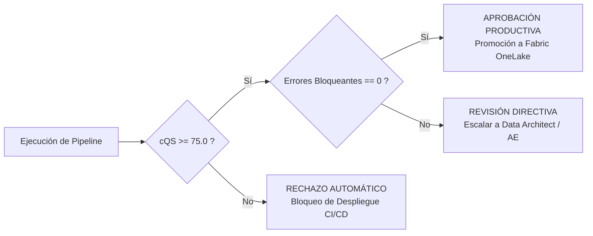

# Acciones Directivas C-Level: Data Leadership Cockpit

Este documento describe el protocolo de gobernanza y toma de decisiones para líderes de datos (CDO, Vicepresidentes y Directores) al evaluar proyectos semánticos en SemanticFlow.

---

## 1. Protocolo de Aprobación de Quality Gates ($cQS$)

Antes de autorizar la sincronización de un modelo semántico con el workspace productivo de Microsoft Fabric o Power BI Service, el líder de datos debe verificar el Quality Gate:

### Acciones Directivas ante Fallo:
1. **Rechazo Inmediato si $cQS < 75.0$:** Ningún modelo con ambigüedad relacional o filtrado cruzado bidireccional no controlado puede pasar a producción.
2. **Escalamiento según Severidad:**
   - Si el fallo es por ciclos en el dígrafo relacional $\rightarrow$ Asignar acción correctiva al **Data Architect**.
   - Si el fallo es por atributos sensibles PII sin enmascarar $\rightarrow$ Escalar al **Data Governance Officer** y **Compliance Auditor**.
   - Si el fallo es por medidas DAX redundantes o Cartesian Joins $\rightarrow$ Derivar al **Analytics Engineer**.

---

## 2. Acciones de Optimización FinOps y Capacidad Cloud

El Cockpit reporta el footprint estimado de cómputo y memoria del modelo en Microsoft Fabric:

1. **Revisión de Tablas de Hechos Masivas:** Validar si tablas con más de 100M de registros operan en modo **Direct Lake** en lugar de Import masivo para no saturar la memoria RAM del Fabric Capacity (F-SKU).
2. **Eliminación de Medidas Huérfanas:** Revisar la sección de medidas no consumidas para desestimar cálculos DAX que aumentan el tiempo de procesamiento de Power BI Desktop y Service.
3. **Control de Presupuesto:** Asegurar que las entidades marcadas con etiquetas de costo tengan su respectivo centro de costo en la gobernanza.

---

## 3. Matriz de Gobernanza RACI Directiva

| Decisión / Artefacto | CDO / Analytics Leader | Data Architect | Data Governance | Analytics Engineer |
| :--- | :---: | :---: | :---: | :---: |
| **Aprobación de Pase a Producción** | **Accountable (A)** | Consulted (C) | Consulted (C) | Responsible (R) |
| **Certificación de KPIs Corporativos** | Consulted (C) | Consulted (C) | **Accountable (A)** | Responsible (R) |
| **Definición de Topología Relacional** | Informed (I) | **Accountable (A)** | Consulted (C) | Responsible (R) |
| **Presupuesto y Capacidades Fabric (F-SKUs)** | **Accountable (A)** | Consulted (C) | Informed (I) | Consulted (C) |
| **Gestión de Excepciones Regulatorias** | Informed (I) | Informed (I) | **Accountable (A)** | Consulted (C) |

---

## 4. Checklist Directivo para Nuevos Proyectos

- [ ] ¿El modelo cuenta con un responsable de dominio de negocio asignado (`domain_owner`)?
- [ ] ¿Las métricas clave reportan un cálculo unívoco sin definiciones duplicadas?
- [ ] ¿El radar de madurez supera el 80% en los cuadrantes de Salud y Cumplimiento?
- [ ] ¿Las dependencias entre equipos técnicos están claramente mapeadas en el reporte del Cockpit?
