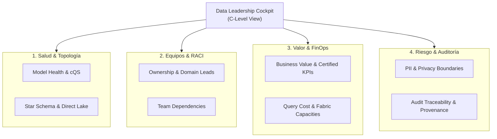

# Data Leadership Cockpit - Visión Global Cross-Lens & Gobierno C-Level

El **Data Leadership Cockpit** es el centro de mando ejecutivo de SemanticFlow diseñado para Chief Data Officers (CDO), Vicepresidentes de Analítica, Directores de TI y Líderes de Producto de Datos.

A diferencia de los reportes técnicos individuales, el Cockpit sintetiza y correlaciona **todas las 16 Persona Lenses** en una visión holística de salud, riesgo, valor de negocio y madurez de la plataforma de datos.

---

## 1. Arquitectura y Pilares del Cockpit

El Cockpit opera bajo un modelo de evaluación en **8 Dominios de Liderazgo**:

---

## 2. Visión Global de las 16 Persona Lenses

El Cockpit consolida de manera no redundante las proyecciones de las 16 lentes organizacionales:

| Cuadrante | Persona Lens | Nivel Técnico | Foco de Observabilidad en el Cockpit |
| :--- | :--- | :--- | :--- |
| **Estratégico / C-Level** | **Analytics Leader** (`CDO`) | `EXECUTIVE` | Radar de madurez consolidado (0-100%), alineación estratégica y backlog de modernización. |
| **Estratégico / C-Level** | **Data Product Manager** | `SUMMARY` | Cumplimiento de SLAs, valor del producto analítico y roadmap de entregables. |
| **Financiero / Cloud** | **FinOps Specialist** | `SUMMARY` | Consumo de cómputo, costo por consulta DAX/SQL y proyección de F-SKUs en Fabric. |
| **Gobierno & Legal** | **Data Governance Officer** | `SUMMARY` | Certificación de métricas, catálogo maestro y políticas de enmascaramiento. |
| **Gobierno & Legal** | **Audit & Risk Officer** | `EXHAUSTIVE` | Trazabilidad forense, gestión de excepciones y riesgos de dependencia de datos. |
| **Gobierno & Legal** | **Compliance Auditor** | `EXHAUSTIVE` | Cumplimiento normativo estricto (GDPR, Ley 19.628, SOX) y linaje regulatorio. |
| **Negocio & Consumo** | **Domain Owner** | `SUMMARY` | Cobertura de entidades de dominio de negocio y adopción operativa. |
| **Negocio & Consumo** | **Business Consumer** | `SUMMARY` | Simplicidad de exploración self-service y claridad de nomenclatura funcional. |
| **Negocio & Consumo** | **Data Analyst** | `SUMMARY` | Catálogo de dimensiones limpias y medidas certificadas listas para reporte. |
| **Ingeniería & Entrega** | **Analytics Engineer** | `TECHNICAL` | Topología de estrella, dimensionalidad, granularidad y modelos dbt MetricFlow. |
| **Ingeniería & Entrega** | **Data Engineer** | `TECHNICAL` | Integridad de particionamiento, esquemas físicos y salud de pipelines upstream. |
| **Ingeniería & Entrega** | **BI Developer** | `TECHNICAL` | Eficiencia DAX, carpetas de despliegue y compatibilidad TMDL/PBIP. |
| **Plataforma & Core** | **Data Architect** | `EXHAUSTIVE` | Dígrafo canónico, componentes fuertemente conexos (SCC) y ciclo de vida de entidades. |
| **Plataforma & Core** | **Platform Engineer** | `TECHNICAL` | Modos de almacenamiento (Import vs. Direct Lake), cuotas de RAM y tiempos de refresh. |
| **IA & Data Science** | **Data Scientist** | `TECHNICAL` | Disponibilidad de features continuas, estabilidad de granos y variables de entrenamiento. |
| **IA & Data Science** | **AI Systems Engineer** | `TECHNICAL` | Compatibilidad con Feature Stores, embeddings vectoriales y consultas de baja latencia. |

---

## 3. Radar de Madurez Multidimensional (0 - 100%)

Cada vez que se ejecuta el pipeline, el motor del Cockpit evalúa la adherencia técnica y operativa del proyecto calculando un score porcentual por dominio:

- **Banda Verde ($\ge 80\%$ - Óptimo):** El dominio cumple con los estándares empresariales; aprobado para despliegue productivo autónomo.
- **Banda Amarilla ($65\% - 79.9\%$ - Satisfactorio):** El modelo es operable pero presenta advertencias de optimización o falta de descripciones de negocio.
- **Banda Roja ($< 65\%$ - Atención Requerida):** Existen brechas estructurales, falta de claves primarias o ambigüedad relacional que deben ser atendidas antes del pase a producción.
