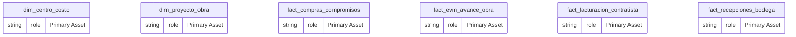

# Perspectiva Operativa: Jefe de Obra y Control de Faena

**Persona Role**: `CUSTOM` | **Technical Depth**: `SUMMARY`

## Executive Summary

> [!NOTE]
> Perspectiva Operativa para Jefe de Obra y Control de Obras en 'schema'. Monitoreo de 6 entidades primarias, 5 KPIs foco y 21 relaciones operativas.

### Focus Areas
- **Business Value**
- **Modeling Quality**
- **Pipeline Health**

## Metrics & KPIs Portfolio

### Certified Metrics
| Metric Name | Status | Type |
| :--- | :--- | :--- |
| **EVM_CPI_Indice_Costo** | Certified | KPI / Core Metric |
| **EVM_SPI_Indice_Plazo** | Certified | KPI / Core Metric |
| **Porcentaje_Avance_Fisico_Ponderado** | Certified | KPI / Core Metric |
| **Rotacion_Consumo_Materiales_Criticos** | Certified | KPI / Core Metric |
| **Tasa_Cumplimiento_EP_Seguridad_Obra** | Certified | KPI / Core Metric |

## Entity Scope

- **Primary Entities (6)**: `dim_centro_costo`, `dim_proyecto_obra`, `fact_compras_compromisos`, `fact_evm_avance_obra`, `fact_facturacion_contratista`, `fact_recepciones_bodega`
- **Secondary Entities (8)**: `DIM_EMPRESA_SOCIEDAD`, `dim_partida_edt`, `dim_tercero`, `dim_tiempo`, `dim_unidad_inmobiliaria`, `fact_postventa_servicio`, `fact_ventas_inmobiliarias`, `seguridad_usuarios_obra`
- **Active Relationships**: 21

### Entity Topology Diagram

## Actionable Recommendations

| ID | Priority | Title | Impact | Effort | Suggested Action |
| :--- | :--- | :--- | :--- | :--- | :--- |
| `17_JEFE_OBRA_CONTROL-KPI-GAP-009` | **MEDIUM** | Implementar KPI de Dominio en Esquema: EVM_SPI_Indice_Plazo | Cobertura completa del tablero de control de dominio | Bajo | Declarar medida DAX: DIVIDE([EVM_EV_Total], [EVM_PV_Total], 0) |
| `17_JEFE_OBRA_CONTROL-KPI-GAP-010` | **MEDIUM** | Implementar KPI de Dominio en Esquema: EVM_CPI_Indice_Costo | Cobertura completa del tablero de control de dominio | Bajo | Declarar medida DAX: DIVIDE([EVM_EV_Total], [EVM_AC_Total], 0) |
| `17_JEFE_OBRA_CONTROL-KPI-GAP-011` | **MEDIUM** | Implementar KPI de Dominio en Esquema: Porcentaje_Avance_Fisico_Ponderado | Cobertura completa del tablero de control de dominio | Bajo | Declarar medida DAX: DIVIDE(SUM(FACT_EVM_AVANCE_OBRA[monto_ev_uf]), SUM(FACT_EVM_AVANCE_OBRA[monto_bac_uf]), 0) * 100 |
| `17_JEFE_OBRA_CONTROL-KPI-GAP-012` | **MEDIUM** | Implementar KPI de Dominio en Esquema: Rotacion_Consumo_Materiales_Criticos | Cobertura completa del tablero de control de dominio | Bajo | Declarar medida DAX: DIVIDE(SUM(FACT_RECEPCIONES_BODEGA[monto_neto_uf]), SUM(FACT_COMPRAS_COMPROMISOS[monto_neto_uf]), 0) |
| `17_JEFE_OBRA_CONTROL-KPI-GAP-013` | **MEDIUM** | Implementar KPI de Dominio en Esquema: Tasa_Cumplimiento_EP_Seguridad_Obra | Cobertura completa del tablero de control de dominio | Bajo | Declarar medida DAX: DIVIDE(COUNTROWS(FACT_FACTURACION_CONTRATISTA), COUNTROWS(FACT_COMPRAS_COMPROMISOS), 0) * 100 |
| `17_JEFE_OBRA_CONTROL-REC-001` | **MEDIUM** | Guía Operativa: ¿Cuál es la variación del plazo (SV) en las partidas crítica | Optimización de control de gestión y toma de decisiones operativas | Medio | Incorporar en el tablero de control del rol |
| `17_JEFE_OBRA_CONTROL-REC-002` | **MEDIUM** | Guía Operativa: ¿El índice de costo (CPI) de la faena se encuentra por encim | Optimización de control de gestión y toma de decisiones operativas | Medio | Incorporar en el tablero de control del rol |
| `17_JEFE_OBRA_CONTROL-REC-003` | **MEDIUM** | Guía Operativa: ¿Existen recepciones en bodega (OPDN) pendientes de facturar | Optimización de control de gestión y toma de decisiones operativas | Medio | Incorporar en el tablero de control del rol |
| `17_JEFE_OBRA_CONTROL-REC-004` | **MEDIUM** | Guía Operativa: ¿Todos los contratistas cuentan con certificación laboral F3 | Optimización de control de gestión y toma de decisiones operativas | Medio | Incorporar en el tablero de control del rol |
| `QG_SANTOLAYA_EVM_001` | **HIGH** | Consistencia de Partidas EVM con Centro de Costo | Gobernanza y confiabilidad del modelo de datos | Bajo | Verificar en auditoría cQS |
| `QG_SANTOLAYA_PROC_002` | **MEDIUM** | Trazabilidad de Órdenes de Compra y Recepción en Bodega | Gobernanza y confiabilidad del modelo de datos | Bajo | Verificar en auditoría cQS |
| `REC-JO-001` | **HIGH** | Auditoría de Curva S y Mitigación de Desviación SPI | Prevención de multas contractuales por atraso de entrega | Bajo | Reasignar cuadrillas de subcontratistas en partidas con holgura cero |
| `REC-JO-002` | **MEDIUM** | Conciliación de Entregas de Hormigón y Cubicaciones | Control estricto de mermas de insumos críticos de obra | Medio | Exigir número de guía SAP en cada recepción de obra |
