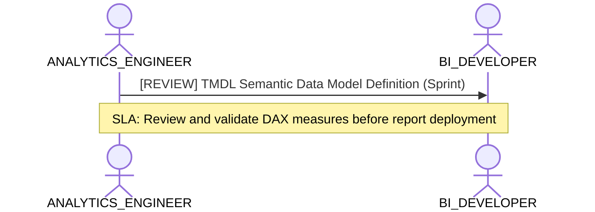

# Analytics Engineering, Dimensional Modeling & Transformation Lens

**Persona Role**: `ANALYTICS_ENGINEER` | **Technical Depth**: `TECHNICAL`
**Generated At**: `2026-10-17T00:56:17.166540+00:00`

## Executive Summary

> [!NOTE]
> Star-schema topology, semantic metrics, SQL transformations, and grain definitions for esquema_estrella_unificado_santolaya.

### Focus Areas
- **Data Modeling**
- **Modeling Quality**

## Metrics & KPIs Portfolio

_No certified metrics assigned to this primary scope._

## Entity Scope

- **Primary Entities (14)**: `dim_proyecto_obra`, `dim_tiempo`, `dim_tercero`, `dim_centro_costo`, `dim_partida_edt`, `dim_unidad_inmobiliaria`, `fact_evm_avance_obra`, `fact_compras_compromisos`, `fact_recepciones_bodega`, `fact_facturacion_contratista`, `fact_ventas_inmobiliarias`, `fact_postventa_servicio`, `seguridad_usuarios_obra`, `DIM_EMPRESA_SOCIEDAD`
- **Active Relationships**: 27

### Entity Topology Diagram

```mermaid
erDiagram
    dim_proyecto_obra {
        string role "Primary Asset"
    }
    dim_tiempo {
        string role "Primary Asset"
    }
    dim_tercero {
        string role "Primary Asset"
    }
    dim_centro_costo {
        string role "Primary Asset"
    }
    dim_partida_edt {
        string role "Primary Asset"
    }
    dim_unidad_inmobiliaria {
        string role "Primary Asset"
    }
    fact_evm_avance_obra {
        string role "Primary Asset"
    }
    fact_compras_compromisos {
        string role "Primary Asset"
    }
    fact_recepciones_bodega {
        string role "Primary Asset"
    }
    fact_facturacion_contratista {
        string role "Primary Asset"
    }
```

## RACI Responsibility Matrix

| Task / Artifact | RACI Role | Description | Collaborators |
| :--- | :--- | :--- | :--- |
| Dimensional Modeling & Semantic Metrics | **RESPONSIBLE** | Authors clean star schemas, conformed dimensions, metric formulas, and grain invariants. | DATA_ENGINEER, BI_DEVELOPER |

## Cross-Functional Team Interactions

| Target Persona | Interaction Type | Frequency | Artifact / Interface | SLA / Expectation |
| :--- | :--- | :--- | :--- | :--- |
| **BI_DEVELOPER** | review | Sprint | `TMDL Semantic Data Model Definition` | Review and validate DAX measures before report deployment |

### Interaction Flow

## Domain Maturity Assessment

**Overall Score**: `80.0/100.0` (Defined)

| Maturity Dimension | Score | Level | Findings |
| :--- | :--- | :--- | :--- |
| Star Schema Conformance | 90.0% | Defined | 27 active relationships |
| Metric Formalization | 70.0% | Optimizing | 0 metrics defined |

### Strengths
- Explicit relationships between fact and dimensions
- Multi-dialect metric support

### Areas for Improvement
- Document complex ratio metric calculations in markdown schema
