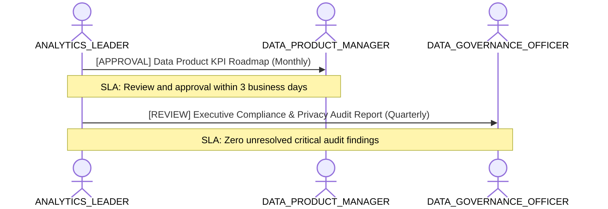

# Perspectiva C-Level: Retorno de Cartera Inmobiliaria y Control EVM

**Persona Role**: `ANALYTICS_LEADER` | **Technical Depth**: `EXECUTIVE`
**Generated At**: `2026-10-23T00:48:40.855644+00:00`

## Executive Summary

> [!NOTE]
> Executive portfolio perspective for schema highlighting strategic KPIs and domain maturity.

### Focus Areas
- **Strategic Alignment**
- **Business Value**
- **Cost Capacity**

## Metrics & KPIs Portfolio

### Certified Metrics
| Metric Name | Status | Type |
| :--- | :--- | :--- |
| **Ventas_UF_Total** | Certified | KPI / Core Metric |
| **EVM_EV_Total** | Certified | KPI / Core Metric |
| **EVM_CPI_Indice_Costo** | Certified | KPI / Core Metric |

## Entity Scope

- **Primary Entities (7)**: `fact_evm_avance_obra`, `fact_compras_compromisos`, `fact_recepciones_bodega`, `fact_facturacion_contratista`, `fact_ventas_inmobiliarias`, `fact_postventa_servicio`, `DIM_PROYECTO_OBRA`
- **Secondary Entities (7)**: `dim_tiempo`, `dim_tercero`, `dim_centro_costo`, `dim_partida_edt`, `dim_unidad_inmobiliaria`, `seguridad_usuarios_obra`, `DIM_EMPRESA_SOCIEDAD`
- **Active Relationships**: 27

### Entity Topology Diagram

```mermaid
erDiagram
    fact_evm_avance_obra {
        string role "Primary Asset"
    }
    fact_compras_compromisos {
        string role "Primary Asset"
    }
    fact_recepciones_bodega {
        string role "Primary Asset"
    }
    fact_facturacion_contratista {
        string role "Primary Asset"
    }
    fact_ventas_inmobiliarias {
        string role "Primary Asset"
    }
    fact_postventa_servicio {
        string role "Primary Asset"
    }
    DIM_PROYECTO_OBRA {
        string role "Primary Asset"
    }
```

## RACI Responsibility Matrix

| Task / Artifact | RACI Role | Description | Collaborators |
| :--- | :--- | :--- | :--- |
| Enterprise Data & AI Strategy | **ACCOUNTABLE** | Sets data monetization, governance principles, and enterprise KPI taxonomy. | DATA_PRODUCT_MANAGER, DATA_GOVERNANCE_OFFICER |

## Cross-Functional Team Interactions

| Target Persona | Interaction Type | Frequency | Artifact / Interface | SLA / Expectation |
| :--- | :--- | :--- | :--- | :--- |
| **DATA_PRODUCT_MANAGER** | approval | Monthly | `Data Product KPI Roadmap` | Review and approval within 3 business days |
| **DATA_GOVERNANCE_OFFICER** | review | Quarterly | `Executive Compliance & Privacy Audit Report` | Zero unresolved critical audit findings |

### Interaction Flow

## Actionable Recommendations

| ID | Priority | Title | Impact | Effort | Suggested Action |
| :--- | :--- | :--- | :--- | :--- | :--- |
| `EXEC-01` | **HIGH** | Expand Certified Metric Coverage | Ensures single source of truth for C-level dashboards | Low | Review and certify unverified metrics in domain entities. |

## Domain Maturity Assessment

**Overall Score**: `54.0/100.0` (Managed)

| Maturity Dimension | Score | Level | Findings |
| :--- | :--- | :--- | :--- |
| Strategic KPI Governance | 90.0% | Defined | 0 certified KPIs |
| Domain Ownership | 85.0% | Managed | Project-level governance active |

### Strengths
- Established strategic focus
- Clear executive ownership

### Areas for Improvement
- Continuous metric certification monitoring
