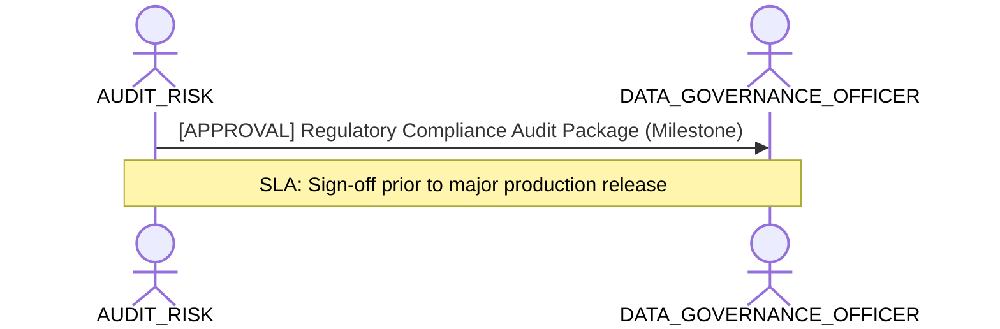

# Regulatory Compliance, Audit Provenance & Risk Lens

**Persona Role**: `AUDIT_RISK` | **Technical Depth**: `EXHAUSTIVE`
**Generated At**: `2026-10-17T00:56:17.167537+00:00`

## Executive Summary

> [!NOTE]
> Regulatory compliance (GDPR/SOX), provenance audit trail, and risk exceptions for esquema_estrella_unificado_santolaya.

### Focus Areas
- **Audit Traceability**
- **Governance Compliance**

## Metrics & KPIs Portfolio

_No certified metrics assigned to this primary scope._

## Entity Scope

- **Primary Entities (14)**: `dim_proyecto_obra`, `dim_tiempo`, `dim_tercero`, `dim_centro_costo`, `dim_partida_edt`, `dim_unidad_inmobiliaria`, `fact_evm_avance_obra`, `fact_compras_compromisos`, `fact_recepciones_bodega`, `fact_facturacion_contratista`, `fact_ventas_inmobiliarias`, `fact_postventa_servicio`, `seguridad_usuarios_obra`, `DIM_EMPRESA_SOCIEDAD`
- **Active Relationships**: 27

### Entity Topology Diagram

```mermaid
erDiagram
    dim_proyecto_obra {
        string role "Primary Asset"
    }
    dim_tiempo {
        string role "Primary Asset"
    }
    dim_tercero {
        string role "Primary Asset"
    }
    dim_centro_costo {
        string role "Primary Asset"
    }
    dim_partida_edt {
        string role "Primary Asset"
    }
    dim_unidad_inmobiliaria {
        string role "Primary Asset"
    }
    fact_evm_avance_obra {
        string role "Primary Asset"
    }
    fact_compras_compromisos {
        string role "Primary Asset"
    }
    fact_recepciones_bodega {
        string role "Primary Asset"
    }
    fact_facturacion_contratista {
        string role "Primary Asset"
    }
```

## RACI Responsibility Matrix

| Task / Artifact | RACI Role | Description | Collaborators |
| :--- | :--- | :--- | :--- |
| Regulatory Audit Traceability & Risk Exception Governance | **ACCOUNTABLE** | Governs regulatory compliance (GDPR, SOX), provenance logs, and risk exceptions. | DATA_GOVERNANCE_OFFICER, DATA_ARCHITECT |

## Cross-Functional Team Interactions

| Target Persona | Interaction Type | Frequency | Artifact / Interface | SLA / Expectation |
| :--- | :--- | :--- | :--- | :--- |
| **DATA_GOVERNANCE_OFFICER** | approval | Milestone | `Regulatory Compliance Audit Package` | Sign-off prior to major production release |

### Interaction Flow

## Actionable Recommendations

| ID | Priority | Title | Impact | Effort | Suggested Action |
| :--- | :--- | :--- | :--- | :--- | :--- |
| `REC-RISK-001` | **HIGH** | Verify Complete End-to-End Transformation Provenance | Guarantees full audit defense and regulatory compliance for financial metrics. | Medium | Ensure all calculated metrics retain provenance records to source columns. |

## Domain Maturity Assessment

**Overall Score**: `94.0/100.0` (Optimizing)

| Maturity Dimension | Score | Level | Findings |
| :--- | :--- | :--- | :--- |
| Audit Traceability | 94.0% | Optimizing | Full provenance log maintained |

### Strengths
- Complete rule provenance records
- Strict PII boundary enforcement

### Areas for Improvement
- Automated compliance change logging
