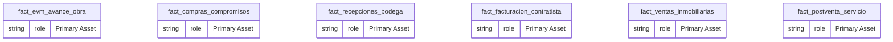
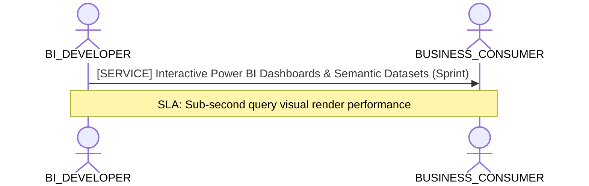

# Modelo Direct Lake Gold OneLake - Rendimiento F8 y V-Order

**Persona Role**: `BI_DEVELOPER` | **Technical Depth**: `TECHNICAL`
**Generated At**: `2026-10-23T00:48:40.855644+00:00`

## Executive Summary

> [!NOTE]
> Power BI / TMDL semantic measures, relationships, DAX formulas, and display folders for schema.

### Focus Areas
- **Visualization Efficiency**
- **Cost Capacity**

## Metrics & KPIs Portfolio

### Certified Metrics
| Metric Name | Status | Type |
| :--- | :--- | :--- |
| **Desviacion_Plazo_Critico_Dias** | Certified | KPI / Core Metric |
| **Indice_Desempeno_Costo_CPI** | Certified | KPI / Core Metric |

## Entity Scope

- **Primary Entities (6)**: `fact_evm_avance_obra`, `fact_compras_compromisos`, `fact_recepciones_bodega`, `fact_facturacion_contratista`, `fact_ventas_inmobiliarias`, `fact_postventa_servicio`
- **Secondary Entities (8)**: `dim_proyecto_obra`, `dim_tiempo`, `dim_tercero`, `dim_centro_costo`, `dim_partida_edt`, `dim_unidad_inmobiliaria`, `seguridad_usuarios_obra`, `DIM_EMPRESA_SOCIEDAD`
- **Active Relationships**: 27

### Entity Topology Diagram

## RACI Responsibility Matrix

| Task / Artifact | RACI Role | Description | Collaborators |
| :--- | :--- | :--- | :--- |
| TMDL Semantic Model & Report Canvases | **RESPONSIBLE** | Generates PBIP/TMDL models, optimizes DAX measures, formats numbers, and maintains visual dashboards. | ANALYTICS_ENGINEER, BUSINESS_CONSUMER |

## Cross-Functional Team Interactions

| Target Persona | Interaction Type | Frequency | Artifact / Interface | SLA / Expectation |
| :--- | :--- | :--- | :--- | :--- |
| **BUSINESS_CONSUMER** | service | Sprint | `Interactive Power BI Dashboards & Semantic Datasets` | Sub-second query visual render performance |

### Interaction Flow

## Domain Maturity Assessment

**Overall Score**: `90.0/100.0` (Optimizing)

| Maturity Dimension | Score | Level | Findings |
| :--- | :--- | :--- | :--- |
| TMDL/PowerBI Compatibility | 95.0% | Optimizing | Native PBIP target emitter supported |
| Measure Definition Quality | 85.0% | Defined | 0 measures in model |

### Strengths
- Clean separation of measures and dimensions
- Deterministic TMDL emission

### Areas for Improvement
- Add automated DAX query performance tests
