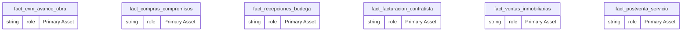
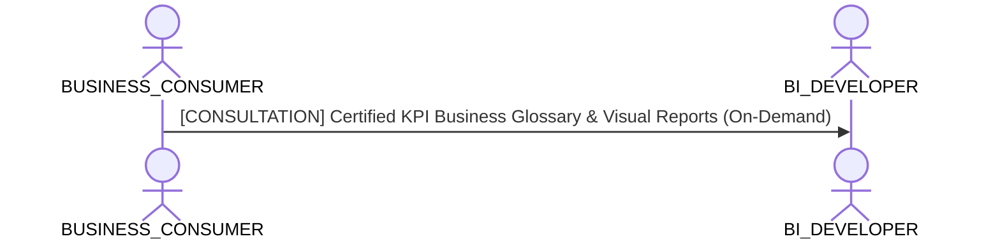

# Business Consumer & Self-Service Analytics Lens

**Persona Role**: `BUSINESS_CONSUMER` | **Technical Depth**: `EXECUTIVE`
**Generated At**: `2026-10-17T00:56:17.167537+00:00`

## Executive Summary

> [!NOTE]
> Certified business terms, plain-language metric glossary, and intuitive report navigation for esquema_estrella_unificado_santolaya.

### Focus Areas
- **Consumption Simplicity**
- **Business Value**

## Metrics & KPIs Portfolio

_No certified metrics assigned to this primary scope._

## Entity Scope

- **Primary Entities (6)**: `fact_evm_avance_obra`, `fact_compras_compromisos`, `fact_recepciones_bodega`, `fact_facturacion_contratista`, `fact_ventas_inmobiliarias`, `fact_postventa_servicio`
- **Secondary Entities (8)**: `dim_proyecto_obra`, `dim_tiempo`, `dim_tercero`, `dim_centro_costo`, `dim_partida_edt`, `dim_unidad_inmobiliaria`, `seguridad_usuarios_obra`, `DIM_EMPRESA_SOCIEDAD`
- **Active Relationships**: 27

### Entity Topology Diagram

## RACI Responsibility Matrix

| Task / Artifact | RACI Role | Description | Collaborators |
| :--- | :--- | :--- | :--- |
| Self-Service Business Exploration | **INFORMED** | Uses certified datasets and dashboards to drive data-informed operational decisions. | BI_DEVELOPER, DATA_PRODUCT_MANAGER |

## Cross-Functional Team Interactions

| Target Persona | Interaction Type | Frequency | Artifact / Interface | SLA / Expectation |
| :--- | :--- | :--- | :--- | :--- |
| **BI_DEVELOPER** | consultation | On-Demand | `Certified KPI Business Glossary & Visual Reports` | - |

### Interaction Flow

## Domain Maturity Assessment

**Overall Score**: `88.0/100.0` (Defined)

| Maturity Dimension | Score | Level | Findings |
| :--- | :--- | :--- | :--- |
| Business Taxonomy Clarity | 88.0% | Defined | 0 certified terms available |
| Self-Service Ease | 90.0% | Optimizing | Simplified executive-level view |

### Strengths
- Clean non-technical abstraction
- Direct KPI visibility

### Areas for Improvement
- Interactive natural language search over business definitions
