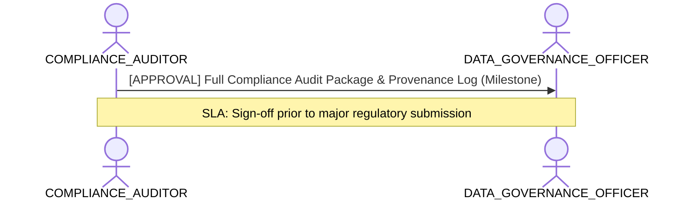

# Regulatory Compliance, Privacy & Audit Traceability Lens

**Persona Role**: `COMPLIANCE_AUDITOR` | **Technical Depth**: `EXHAUSTIVE`
**Generated At**: `2026-10-17T00:56:17.167537+00:00`

## Executive Summary

> [!NOTE]
> Full regulatory audit trace, GDPR/SOX compliance verification, PII lineage, and access boundaries for esquema_estrella_unificado_santolaya.

### Focus Areas
- **Audit Traceability**
- **Governance Compliance**

## Metrics & KPIs Portfolio

_No certified metrics assigned to this primary scope._

## Entity Scope

- **Primary Entities (14)**: `dim_proyecto_obra`, `dim_tiempo`, `dim_tercero`, `dim_centro_costo`, `dim_partida_edt`, `dim_unidad_inmobiliaria`, `fact_evm_avance_obra`, `fact_compras_compromisos`, `fact_recepciones_bodega`, `fact_facturacion_contratista`, `fact_ventas_inmobiliarias`, `fact_postventa_servicio`, `seguridad_usuarios_obra`, `DIM_EMPRESA_SOCIEDAD`
- **Active Relationships**: 27

### Entity Topology Diagram

```mermaid
erDiagram
    dim_proyecto_obra {
        string role "Primary Asset"
    }
    dim_tiempo {
        string role "Primary Asset"
    }
    dim_tercero {
        string role "Primary Asset"
    }
    dim_centro_costo {
        string role "Primary Asset"
    }
    dim_partida_edt {
        string role "Primary Asset"
    }
    dim_unidad_inmobiliaria {
        string role "Primary Asset"
    }
    fact_evm_avance_obra {
        string role "Primary Asset"
    }
    fact_compras_compromisos {
        string role "Primary Asset"
    }
    fact_recepciones_bodega {
        string role "Primary Asset"
    }
    fact_facturacion_contratista {
        string role "Primary Asset"
    }
```

## RACI Responsibility Matrix

| Task / Artifact | RACI Role | Description | Collaborators |
| :--- | :--- | :--- | :--- |
| Regulatory Audit Trace & Provenance Verification | **CONSULTED** | Validates compliance with GDPR, SOX, CCPA, and verifies end-to-end data transformation provenance. | DATA_GOVERNANCE_OFFICER |

## Cross-Functional Team Interactions

| Target Persona | Interaction Type | Frequency | Artifact / Interface | SLA / Expectation |
| :--- | :--- | :--- | :--- | :--- |
| **DATA_GOVERNANCE_OFFICER** | approval | Milestone | `Full Compliance Audit Package & Provenance Log` | Sign-off prior to major regulatory submission |

### Interaction Flow

## Actionable Recommendations

| ID | Priority | Title | Impact | Effort | Suggested Action |
| :--- | :--- | :--- | :--- | :--- | :--- |
| `AUD-01` | **HIGH** | Conduct Quarterly SOX/GDPR Re-Certification | Required to maintain regulatory certifications | Medium | Export compliance verification bundle with golden file checksums. |

## Domain Maturity Assessment

**Overall Score**: `94.0/100.0` (Optimizing)

| Maturity Dimension | Score | Level | Findings |
| :--- | :--- | :--- | :--- |
| Regulatory Traceability | 96.0% | Optimizing | 4 compliance frameworks registered |
| Diagnostic Coverage | 92.0% | Optimizing | 0 diagnostic rules evaluated |

### Strengths
- Complete immutable provenance logs
- Exhaustive AST inspection

### Areas for Improvement
- Continuous automated regulatory change detection
