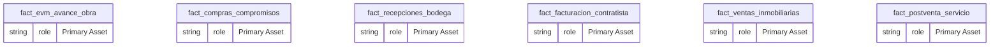
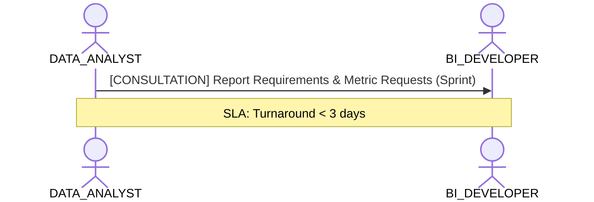

# Data Analyst & Self-Service Consumption Lens

**Persona Role**: `DATA_ANALYST` | **Technical Depth**: `SUMMARY`
**Generated At**: `2026-10-17T00:56:17.167537+00:00`

## Executive Summary

> [!NOTE]
> Certified KPIs, domain dimensions, and self-service exploration catalog for esquema_estrella_unificado_santolaya.

### Focus Areas
- **Consumption Simplicity**
- **Business Value**

## Metrics & KPIs Portfolio

_No certified metrics assigned to this primary scope._

## Entity Scope

- **Primary Entities (6)**: `fact_evm_avance_obra`, `fact_compras_compromisos`, `fact_recepciones_bodega`, `fact_facturacion_contratista`, `fact_ventas_inmobiliarias`, `fact_postventa_servicio`
- **Secondary Entities (8)**: `dim_proyecto_obra`, `dim_tiempo`, `dim_tercero`, `dim_centro_costo`, `dim_partida_edt`, `dim_unidad_inmobiliaria`, `seguridad_usuarios_obra`, `DIM_EMPRESA_SOCIEDAD`
- **Active Relationships**: 27

### Entity Topology Diagram

## RACI Responsibility Matrix

| Task / Artifact | RACI Role | Description | Collaborators |
| :--- | :--- | :--- | :--- |
| Self-Service KPI Consumption & Reporting | **RESPONSIBLE** | Consumes certified dimensions and KPIs to build operational reports. | BI_DEVELOPER, DOMAIN_OWNER |

## Cross-Functional Team Interactions

| Target Persona | Interaction Type | Frequency | Artifact / Interface | SLA / Expectation |
| :--- | :--- | :--- | :--- | :--- |
| **BI_DEVELOPER** | consultation | Sprint | `Report Requirements & Metric Requests` | Turnaround < 3 days |

### Interaction Flow

## Actionable Recommendations

| ID | Priority | Title | Impact | Effort | Suggested Action |
| :--- | :--- | :--- | :--- | :--- | :--- |
| `REC-DA-001` | **MEDIUM** | Review Business Descriptions for Self-Service Exploration | Ensures business consumers understand metric definitions. | Low | Verify all certified KPIs have business definitions. |

## Domain Maturity Assessment

**Overall Score**: `88.0/100.0` (Defined)

| Maturity Dimension | Score | Level | Findings |
| :--- | :--- | :--- | :--- |
| Consumption Simplicity | 88.0% | Defined | Certified metrics ready |

### Strengths
- Standardized metric definitions
- Clear dimension conformances

### Areas for Improvement
- Automated glossary integration
