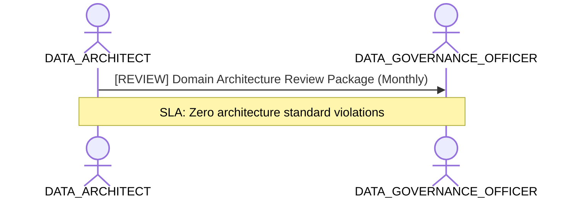

# Enterprise Data Architecture & Domain Modeling Lens

**Persona Role**: `DATA_ARCHITECT` | **Technical Depth**: `EXHAUSTIVE`
**Generated At**: `2026-10-17T00:56:17.167537+00:00`

## Executive Summary

> [!NOTE]
> Relational graph topology, domain conformances, entity lifecycle, and architectural standards for esquema_estrella_unificado_santolaya.

### Focus Areas
- **Data Modeling**
- **Modeling Quality**
- **Strategic Alignment**

## Metrics & KPIs Portfolio

_No certified metrics assigned to this primary scope._

## Entity Scope

- **Primary Entities (14)**: `dim_proyecto_obra`, `dim_tiempo`, `dim_tercero`, `dim_centro_costo`, `dim_partida_edt`, `dim_unidad_inmobiliaria`, `fact_evm_avance_obra`, `fact_compras_compromisos`, `fact_recepciones_bodega`, `fact_facturacion_contratista`, `fact_ventas_inmobiliarias`, `fact_postventa_servicio`, `seguridad_usuarios_obra`, `DIM_EMPRESA_SOCIEDAD`
- **Active Relationships**: 27

### Entity Topology Diagram

```mermaid
erDiagram
    dim_proyecto_obra {
        string role "Primary Asset"
    }
    dim_tiempo {
        string role "Primary Asset"
    }
    dim_tercero {
        string role "Primary Asset"
    }
    dim_centro_costo {
        string role "Primary Asset"
    }
    dim_partida_edt {
        string role "Primary Asset"
    }
    dim_unidad_inmobiliaria {
        string role "Primary Asset"
    }
    fact_evm_avance_obra {
        string role "Primary Asset"
    }
    fact_compras_compromisos {
        string role "Primary Asset"
    }
    fact_recepciones_bodega {
        string role "Primary Asset"
    }
    fact_facturacion_contratista {
        string role "Primary Asset"
    }
```

## RACI Responsibility Matrix

| Task / Artifact | RACI Role | Description | Collaborators |
| :--- | :--- | :--- | :--- |
| Enterprise Semantic Blueprint & Domain Conformity | **ACCOUNTABLE** | Governs semantic entities, relationships DAG, and cross-domain conformance. | ANALYTICS_ENGINEER, DATA_GOVERNANCE_OFFICER |

## Cross-Functional Team Interactions

| Target Persona | Interaction Type | Frequency | Artifact / Interface | SLA / Expectation |
| :--- | :--- | :--- | :--- | :--- |
| **DATA_GOVERNANCE_OFFICER** | review | Monthly | `Domain Architecture Review Package` | Zero architecture standard violations |

### Interaction Flow

## Actionable Recommendations

| ID | Priority | Title | Impact | Effort | Suggested Action |
| :--- | :--- | :--- | :--- | :--- | :--- |
| `REC-ARCH-001` | **HIGH** | Maintain Canonical Semantic Model Vendor Neutrality | Ensures semantic model remains portable across Power BI, Looker, and dbt. | Low | Verify no platform-specific DAX logic is embedded into canonical definitions. |

## Domain Maturity Assessment

**Overall Score**: `92.0/100.0` (Optimizing)

| Maturity Dimension | Score | Level | Findings |
| :--- | :--- | :--- | :--- |
| Architecture Coherence | 92.0% | Optimizing | Canonical model decoupled |

### Strengths
- Vendor-neutral AST representation
- Strict DAG relationship validation

### Areas for Improvement
- Cross-workspace semantic federation
