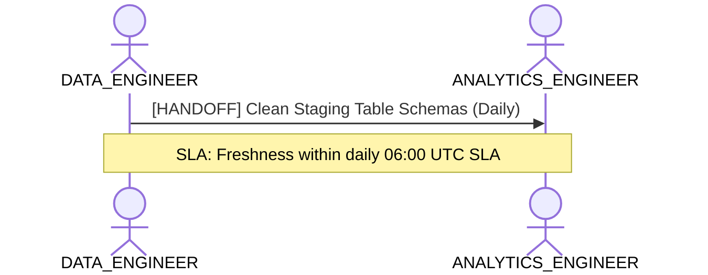

# Data Engineering, Ingestion & Pipeline Health Lens

**Persona Role**: `DATA_ENGINEER` | **Technical Depth**: `TECHNICAL`
**Generated At**: `2026-10-17T00:56:17.167537+00:00`

## Executive Summary

> [!NOTE]
> Physical schema, partition grain, upstream sources, and pipeline integrity for esquema_estrella_unificado_santolaya.

### Focus Areas
- **Pipeline Health**
- **Data Modeling**

## Metrics & KPIs Portfolio

_No certified metrics assigned to this primary scope._

## Entity Scope

- **Primary Entities (14)**: `dim_proyecto_obra`, `dim_tiempo`, `dim_tercero`, `dim_centro_costo`, `dim_partida_edt`, `dim_unidad_inmobiliaria`, `fact_evm_avance_obra`, `fact_compras_compromisos`, `fact_recepciones_bodega`, `fact_facturacion_contratista`, `fact_ventas_inmobiliarias`, `fact_postventa_servicio`, `seguridad_usuarios_obra`, `DIM_EMPRESA_SOCIEDAD`
- **Active Relationships**: 27

### Entity Topology Diagram

```mermaid
erDiagram
    dim_proyecto_obra {
        string role "Primary Asset"
    }
    dim_tiempo {
        string role "Primary Asset"
    }
    dim_tercero {
        string role "Primary Asset"
    }
    dim_centro_costo {
        string role "Primary Asset"
    }
    dim_partida_edt {
        string role "Primary Asset"
    }
    dim_unidad_inmobiliaria {
        string role "Primary Asset"
    }
    fact_evm_avance_obra {
        string role "Primary Asset"
    }
    fact_compras_compromisos {
        string role "Primary Asset"
    }
    fact_recepciones_bodega {
        string role "Primary Asset"
    }
    fact_facturacion_contratista {
        string role "Primary Asset"
    }
```

## RACI Responsibility Matrix

| Task / Artifact | RACI Role | Description | Collaborators |
| :--- | :--- | :--- | :--- |
| Physical Ingestion & Pipeline SLAs | **RESPONSIBLE** | Manages raw data ingestion, table partitioning, change data capture (CDC), and source freshness. | ANALYTICS_ENGINEER |

## Cross-Functional Team Interactions

| Target Persona | Interaction Type | Frequency | Artifact / Interface | SLA / Expectation |
| :--- | :--- | :--- | :--- | :--- |
| **ANALYTICS_ENGINEER** | handoff | Daily | `Clean Staging Table Schemas` | Freshness within daily 06:00 UTC SLA |

### Interaction Flow

## Actionable Recommendations

| ID | Priority | Title | Impact | Effort | Suggested Action |
| :--- | :--- | :--- | :--- | :--- | :--- |
| `DE-GRAIN-dim_proyecto_obra` | **MEDIUM** | Define Explicit Grain for dim_proyecto_obra | Prevents Cartesian product joins and pipeline duplication errors | Low | Declare grain columns in dim_proyecto_obra schema definition. |
| `DE-GRAIN-dim_tiempo` | **MEDIUM** | Define Explicit Grain for dim_tiempo | Prevents Cartesian product joins and pipeline duplication errors | Low | Declare grain columns in dim_tiempo schema definition. |
| `DE-GRAIN-dim_tercero` | **MEDIUM** | Define Explicit Grain for dim_tercero | Prevents Cartesian product joins and pipeline duplication errors | Low | Declare grain columns in dim_tercero schema definition. |
| `DE-GRAIN-dim_centro_costo` | **MEDIUM** | Define Explicit Grain for dim_centro_costo | Prevents Cartesian product joins and pipeline duplication errors | Low | Declare grain columns in dim_centro_costo schema definition. |
| `DE-GRAIN-dim_partida_edt` | **MEDIUM** | Define Explicit Grain for dim_partida_edt | Prevents Cartesian product joins and pipeline duplication errors | Low | Declare grain columns in dim_partida_edt schema definition. |
| `DE-GRAIN-dim_unidad_inmobiliaria` | **MEDIUM** | Define Explicit Grain for dim_unidad_inmobiliaria | Prevents Cartesian product joins and pipeline duplication errors | Low | Declare grain columns in dim_unidad_inmobiliaria schema definition. |
| `DE-GRAIN-fact_evm_avance_obra` | **MEDIUM** | Define Explicit Grain for fact_evm_avance_obra | Prevents Cartesian product joins and pipeline duplication errors | Low | Declare grain columns in fact_evm_avance_obra schema definition. |
| `DE-GRAIN-fact_compras_compromisos` | **MEDIUM** | Define Explicit Grain for fact_compras_compromisos | Prevents Cartesian product joins and pipeline duplication errors | Low | Declare grain columns in fact_compras_compromisos schema definition. |
| `DE-GRAIN-fact_recepciones_bodega` | **MEDIUM** | Define Explicit Grain for fact_recepciones_bodega | Prevents Cartesian product joins and pipeline duplication errors | Low | Declare grain columns in fact_recepciones_bodega schema definition. |
| `DE-GRAIN-fact_facturacion_contratista` | **MEDIUM** | Define Explicit Grain for fact_facturacion_contratista | Prevents Cartesian product joins and pipeline duplication errors | Low | Declare grain columns in fact_facturacion_contratista schema definition. |
| `DE-GRAIN-fact_ventas_inmobiliarias` | **MEDIUM** | Define Explicit Grain for fact_ventas_inmobiliarias | Prevents Cartesian product joins and pipeline duplication errors | Low | Declare grain columns in fact_ventas_inmobiliarias schema definition. |
| `DE-GRAIN-fact_postventa_servicio` | **MEDIUM** | Define Explicit Grain for fact_postventa_servicio | Prevents Cartesian product joins and pipeline duplication errors | Low | Declare grain columns in fact_postventa_servicio schema definition. |
| `DE-GRAIN-seguridad_usuarios_obra` | **MEDIUM** | Define Explicit Grain for seguridad_usuarios_obra | Prevents Cartesian product joins and pipeline duplication errors | Low | Declare grain columns in seguridad_usuarios_obra schema definition. |
| `DE-GRAIN-DIM_EMPRESA_SOCIEDAD` | **MEDIUM** | Define Explicit Grain for DIM_EMPRESA_SOCIEDAD | Prevents Cartesian product joins and pipeline duplication errors | Low | Declare grain columns in DIM_EMPRESA_SOCIEDAD schema definition. |

## Domain Maturity Assessment

**Overall Score**: `45.0/100.0` (Defined)

| Maturity Dimension | Score | Level | Findings |
| :--- | :--- | :--- | :--- |
| Grain Definition Completeness | 0.0% | Defined | 0% entities have explicit grain |
| Physical Type Rigor | 95.0% | Optimizing | Strongly-typed data attributes |

### Strengths
- Explicit data types on all attributes
- Structured entity definitions

### Areas for Improvement
- Verify surrogate key generation in staging layer
