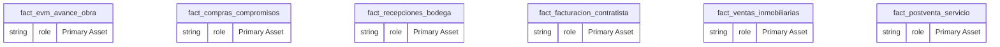
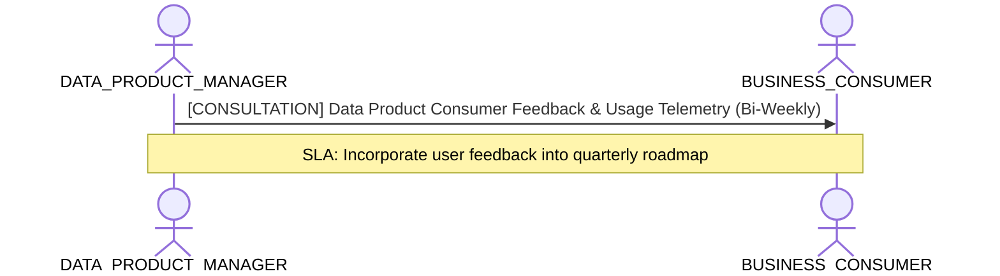

# Data Product Management, Lifecycle & Consumer Value Lens

**Persona Role**: `DATA_PRODUCT_MANAGER` | **Technical Depth**: `SUMMARY`
**Generated At**: `2026-10-17T00:56:17.169532+00:00`

## Executive Summary

> [!NOTE]
> Data product SLA, consumer adoption contracts, release maturity, and product telemetry for esquema_estrella_unificado_santolaya.

### Focus Areas
- **Product Lifecycle**
- **Product Metrics**
- **Business Value**

## Metrics & KPIs Portfolio

_No certified metrics assigned to this primary scope._

## Entity Scope

- **Primary Entities (6)**: `fact_evm_avance_obra`, `fact_compras_compromisos`, `fact_recepciones_bodega`, `fact_facturacion_contratista`, `fact_ventas_inmobiliarias`, `fact_postventa_servicio`
- **Secondary Entities (8)**: `dim_proyecto_obra`, `dim_tiempo`, `dim_tercero`, `dim_centro_costo`, `dim_partida_edt`, `dim_unidad_inmobiliaria`, `seguridad_usuarios_obra`, `DIM_EMPRESA_SOCIEDAD`
- **Active Relationships**: 27

### Entity Topology Diagram

## RACI Responsibility Matrix

| Task / Artifact | RACI Role | Description | Collaborators |
| :--- | :--- | :--- | :--- |
| Data Product Lifecycle & Consumer SLA | **ACCOUNTABLE** | Defines data product boundary, versioning cadence, consumer contracts, and feature enhancements. | ANALYTICS_LEADER, BUSINESS_CONSUMER |

## Cross-Functional Team Interactions

| Target Persona | Interaction Type | Frequency | Artifact / Interface | SLA / Expectation |
| :--- | :--- | :--- | :--- | :--- |
| **BUSINESS_CONSUMER** | consultation | Bi-Weekly | `Data Product Consumer Feedback & Usage Telemetry` | Incorporate user feedback into quarterly roadmap |

### Interaction Flow

## Actionable Recommendations

| ID | Priority | Title | Impact | Effort | Suggested Action |
| :--- | :--- | :--- | :--- | :--- | :--- |
| `DPM-01` | **MEDIUM** | Publish Consumer SLA Contract | Guarantees consumer trust and establishes operational SLOs | Low | Document query latency and freshness SLAs in project governance. |

## Domain Maturity Assessment

**Overall Score**: `95.0/100.0` (Optimizing)

| Maturity Dimension | Score | Level | Findings |
| :--- | :--- | :--- | :--- |
| Product Lifecycle Status | 95.0% | Defined | Status: Certified |
| SLA Commitment | 60.0% | Defined | SLA: None |

### Strengths
- Data product concept applied
- Explicit domain attribution

### Areas for Improvement
- Automated usage analytics integration
