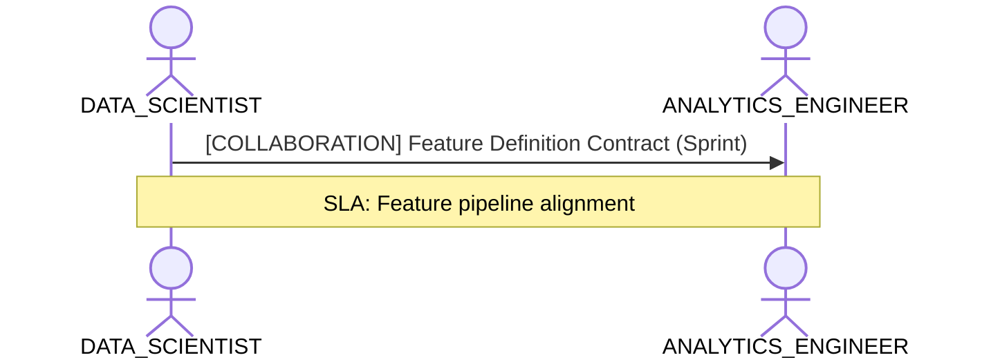

# Data Science, Feature Engineering & Statistical Lens

**Persona Role**: `DATA_SCIENTIST` | **Technical Depth**: `TECHNICAL`
**Generated At**: `2026-10-17T00:56:17.169532+00:00`

## Executive Summary

> [!NOTE]
> Analytical features, continuous variables, entity grains, and training dimensions for esquema_estrella_unificado_santolaya.

### Focus Areas
- **Ai Readiness**
- **Data Modeling**

## Metrics & KPIs Portfolio

_No certified metrics assigned to this primary scope._

## Entity Scope

- **Primary Entities (14)**: `dim_proyecto_obra`, `dim_tiempo`, `dim_tercero`, `dim_centro_costo`, `dim_partida_edt`, `dim_unidad_inmobiliaria`, `fact_evm_avance_obra`, `fact_compras_compromisos`, `fact_recepciones_bodega`, `fact_facturacion_contratista`, `fact_ventas_inmobiliarias`, `fact_postventa_servicio`, `seguridad_usuarios_obra`, `DIM_EMPRESA_SOCIEDAD`
- **Active Relationships**: 27

### Entity Topology Diagram

```mermaid
erDiagram
    dim_proyecto_obra {
        string role "Primary Asset"
    }
    dim_tiempo {
        string role "Primary Asset"
    }
    dim_tercero {
        string role "Primary Asset"
    }
    dim_centro_costo {
        string role "Primary Asset"
    }
    dim_partida_edt {
        string role "Primary Asset"
    }
    dim_unidad_inmobiliaria {
        string role "Primary Asset"
    }
    fact_evm_avance_obra {
        string role "Primary Asset"
    }
    fact_compras_compromisos {
        string role "Primary Asset"
    }
    fact_recepciones_bodega {
        string role "Primary Asset"
    }
    fact_facturacion_contratista {
        string role "Primary Asset"
    }
```

## RACI Responsibility Matrix

| Task / Artifact | RACI Role | Description | Collaborators |
| :--- | :--- | :--- | :--- |
| Predictive Feature Formulation & Statistical Verification | **RESPONSIBLE** | Formulates analytical features and evaluates statistical distributions from semantic entities. | ANALYTICS_ENGINEER, DATA_ENGINEER |

## Cross-Functional Team Interactions

| Target Persona | Interaction Type | Frequency | Artifact / Interface | SLA / Expectation |
| :--- | :--- | :--- | :--- | :--- |
| **ANALYTICS_ENGINEER** | collaboration | Sprint | `Feature Definition Contract` | Feature pipeline alignment |

### Interaction Flow

## Actionable Recommendations

| ID | Priority | Title | Impact | Effort | Suggested Action |
| :--- | :--- | :--- | :--- | :--- | :--- |
| `REC-DS-001` | **MEDIUM** | Verify Feature Cardinality and Numerical Grain | Improves convergence and feature consistency in ML training pipelines. | Medium | Ensure entity grain definitions match expected feature vector dimensions. |

## Domain Maturity Assessment

**Overall Score**: `85.0/100.0` (Defined)

| Maturity Dimension | Score | Level | Findings |
| :--- | :--- | :--- | :--- |
| Feature Engineering Readiness | 85.0% | Defined | Entities mapped |

### Strengths
- Consistent grain definitions
- Clean categorical dimensions

### Areas for Improvement
- Automated feature store synchronization
