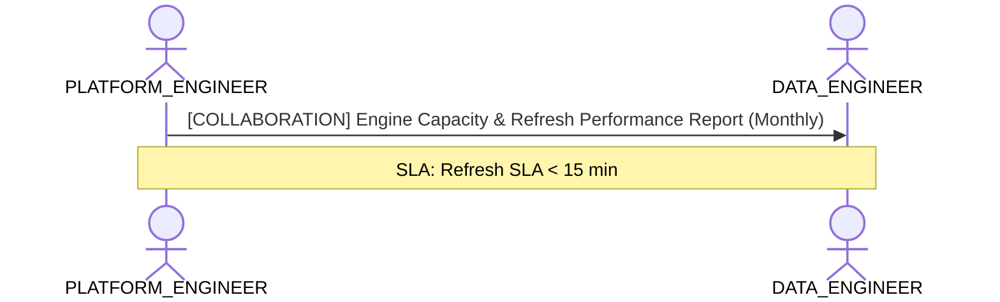

# Data Platform Infrastructure & Storage Capacity Lens

**Persona Role**: `PLATFORM_ENGINEER` | **Technical Depth**: `TECHNICAL`
**Generated At**: `2026-10-23T00:48:40.860637+00:00`

## Executive Summary

> [!NOTE]
> Engine compute capacity, storage modes (Import/DirectLake), partitions, and refresh SLAs for schema.

### Focus Areas
- **Cost Capacity**
- **Pipeline Health**

## Metrics & KPIs Portfolio

_No certified metrics assigned to this primary scope._

## Entity Scope

- **Primary Entities (14)**: `dim_proyecto_obra`, `dim_tiempo`, `dim_tercero`, `dim_centro_costo`, `dim_partida_edt`, `dim_unidad_inmobiliaria`, `fact_evm_avance_obra`, `fact_compras_compromisos`, `fact_recepciones_bodega`, `fact_facturacion_contratista`, `fact_ventas_inmobiliarias`, `fact_postventa_servicio`, `seguridad_usuarios_obra`, `DIM_EMPRESA_SOCIEDAD`
- **Active Relationships**: 27

### Entity Topology Diagram

```mermaid
erDiagram
    dim_proyecto_obra {
        string role "Primary Asset"
    }
    dim_tiempo {
        string role "Primary Asset"
    }
    dim_tercero {
        string role "Primary Asset"
    }
    dim_centro_costo {
        string role "Primary Asset"
    }
    dim_partida_edt {
        string role "Primary Asset"
    }
    dim_unidad_inmobiliaria {
        string role "Primary Asset"
    }
    fact_evm_avance_obra {
        string role "Primary Asset"
    }
    fact_compras_compromisos {
        string role "Primary Asset"
    }
    fact_recepciones_bodega {
        string role "Primary Asset"
    }
    fact_facturacion_contratista {
        string role "Primary Asset"
    }
```

## RACI Responsibility Matrix

| Task / Artifact | RACI Role | Description | Collaborators |
| :--- | :--- | :--- | :--- |
| Semantic Compute Engine Tuning & Storage Allocation | **RESPONSIBLE** | Manages semantic engine memory capacity, autoscaling limits, and storage modes. | DATA_ENGINEER, BI_DEVELOPER |

## Cross-Functional Team Interactions

| Target Persona | Interaction Type | Frequency | Artifact / Interface | SLA / Expectation |
| :--- | :--- | :--- | :--- | :--- |
| **DATA_ENGINEER** | collaboration | Monthly | `Engine Capacity & Refresh Performance Report` | Refresh SLA < 15 min |

### Interaction Flow

## Actionable Recommendations

| ID | Priority | Title | Impact | Effort | Suggested Action |
| :--- | :--- | :--- | :--- | :--- | :--- |
| `REC-PE-001` | **MEDIUM** | Evaluate VertiPaq / Direct Lake Storage Modes for High-Cardinality Entities | Maximizes memory compression and query performance SLAs in Fabric/Power BI. | Medium | Review column cardinalities to optimize VertiPaq memory footprint. |

## Domain Maturity Assessment

**Overall Score**: `87.0/100.0` (Defined)

| Maturity Dimension | Score | Level | Findings |
| :--- | :--- | :--- | :--- |
| Platform Scalability | 87.0% | Defined | Storage modes mapped |

### Strengths
- Predictable VertiPaq compression
- Stable relationship evaluation

### Areas for Improvement
- Automated partition optimization
